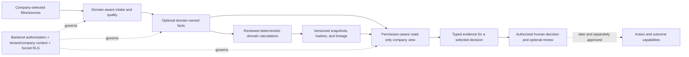

# BusinessFlow Architecture Overview

- **Status:** Current code facts, the historical M9 target direction, the separately scoped M10 synthetic demo, the Phase 3 semantic and bounded Business Intelligence APIs, the bounded M14–M16 finance slices, and the experimental Core Financials shared six-measure increment are deliberately separated. M10 remains synthetic-only; M14–M16 APIs are default-disabled, M15/M16 and Core Financials are hard-blocked in production, and unresolved finance-owner/source/access/correction/retention/independent-control gates do not authorize production accounting-data processing. Phase 3 BI is backend-only and does not provide a unified workspace or approve financial policy.
- **Product direction:** Company-wide Business Intelligence & Decision Platform; see [`product/PRODUCT_VISION.md`](product/PRODUCT_VISION.md).
- **Detailed assessment:** [`architecture/CURRENT_VS_TARGET_GAP_ANALYSIS.md`](architecture/CURRENT_VS_TARGET_GAP_ANALYSIS.md), [`architecture/TARGET_DOMAIN_ARCHITECTURE.md`](architecture/TARGET_DOMAIN_ARCHITECTURE.md), and the [finance/capability matrix](architecture/FINANCIAL_INTELLIGENCE_CAPABILITY_MATRIX.md).

## 1. Current implementation

The repository contains a Python/FastAPI modular-monolith backend using SQLAlchemy, Alembic, and PostgreSQL. Migrations `0001_backend_foundation`–`0023_core_financial_guardrails` cover bounded M2–M8 backend slices, M10, M12–M16, Phase 1 manual customer commitments, Phase 2 Universal Data, the Phase 3 Company-scoped semantic identity/mapping/relationship foundation, the versioned Business Intelligence registry/configuration/analysis persistence, and the default-disabled Core Financials six-measure management-reporting workflow; 0014 restricts runtime account creation and 0015 revokes runtime user-account UPDATE privileges. M9 was documentation-only and M11 is a database-free calculation/verification package. Current modules include identity/tenancy, company context, staged data imports, metrics, project assessments, project decisions, project financial assessments, the synthetic-only monthly position review, the bounded company-data registry, Phase 1 manual customer-commitment capture, Phase 2 CSV/XLSX and optional configured-local-directory staging/mapping/validation/promotion with source-scoped canonical lineage, Phase 3 reviewed Company-scoped semantic identities/mappings and evidence/freshness-checked relationships, the separate versioned Business Intelligence metric registry/configuration/readiness/analysis/replay/evidence API, metric comparisons, the manual finance-source contract/intake, an experimental M15 exact-subtotal prototype, an M16 caller-asserted 13-week direct-cash schedule, and the default-disabled Core Financials six-measure increment. Universal records neither auto-merge across sources nor become Core Financials facts; semantic links are explicit human-reviewed associations, and the BI API reuses existing data/run services without adding ingestion, automatic identity resolution, or financial authority. See [`BUSINESS_SEMANTIC_LAYER.md`](BUSINESS_SEMANTIC_LAYER.md), [`BUSINESS_INTELLIGENCE_PHASE3.md`](BUSINESS_INTELLIGENCE_PHASE3.md), and [`BACKEND_IMPLEMENTATION.md`](BACKEND_IMPLEMENTATION.md), [`M12_COMPANY_DATA_INTELLIGENCE.md`](M12_COMPANY_DATA_INTELLIGENCE.md), [`COMPANY_DATA_FOUNDATION_PHASE1.md`](COMPANY_DATA_FOUNDATION_PHASE1.md), [`COMPANY_DATA_FOUNDATION_PHASE2.md`](COMPANY_DATA_FOUNDATION_PHASE2.md), [`UNIVERSAL_DATA_FOUNDATION.md`](UNIVERSAL_DATA_FOUNDATION.md), [`M13_METRIC_INSIGHTS.md`](M13_METRIC_INSIGHTS.md), [`M14_FINANCE_SOURCE_CONTRACTS.md`](M14_FINANCE_SOURCE_CONTRACTS.md), [`M15_DETERMINISTIC_FINANCIAL_CALCULATIONS.md`](M15_DETERMINISTIC_FINANCIAL_CALCULATIONS.md), [`M16_DIRECT_CASH_FORECAST.md`](M16_DIRECT_CASH_FORECAST.md), [`CORE_FINANCIALS.md`](CORE_FINANCIALS.md), and the source tree under `../src/businessflow/`.

Current business data is narrow: employees, tenant-owned skills, employee skill records, weekly capacity, projects, employee-project assignments, staged imports of those data types, project-scoped intake/decision/financial observations, manually recorded customer-delivery commitments (human assertions only), source-scoped Universal Data records (not cross-source canonical parties or finance facts), explicitly reviewed semantic identity links/relationships, versioned BI metric definitions and Company configurations, and immutable saved analyses with evidence references. M12 adds company-scoped registration of named sources that bind existing M4 imports to six versioned M4 contracts, plus quality/freshness assessments and immutable evidence snapshots; it reuses M4 storage, M5 snapshots, and M4 lineage rather than adding a second importer or copying source rows. Phase 1 adds one separately versioned manual commitment contract and Company-scoped submission/review/evidence history; it does not accept M4 imports for that dataset or produce Core Financials measures. M13 compares only three supported M5 observations with explicit evidence gates and neutral meaning. M14 adds one manual finance-specific CSV contract, explicit mapping/profile/row evidence and caller-supplied Decimal control comparison; it stores no raw row values or canonical finance facts and does not authenticate a source or independent control. The M15 prototype adds a keyed row-amount commitment and one complete-group exact subtotal only; its result is mechanical, not accounting truth or an approved formula. M16 separately adds a default-disabled fixed 13-week known-item cash roll-forward using explicit opening cash and caller-asserted row classification, basis, date, and supersession. M16 does not derive cash meaning or timing from M14 period bounds, does not zero-fill absent categories, and does not claim forecast completeness or accuracy. Phase 3 BI reuses promoted Universal Data records and saved M5/Core Financials runs, pins definitions/configuration/dependency analyses, and supports bounded deterministic calculations, readiness, replay, and paginated evidence; it does not create a new ingestion path, cross-source identity resolution, or financial policy. Projects are one supported business domain, not the product boundary. M5 has five draft, observational non-financial metrics. M8 preserves sourced project financial observations and always reports `incomplete` without an approved financial policy. M10 remains a separate Company-scoped, synthetic-only workflow over exact built-in templates: four operational datasets, optional source-native finance rows, immutable evidence-linked briefs, and human dispositions. It can bind optional M12 ingestion evidence, but M10 remains synthetic-only. M12 reuses the existing M4 file intake for its six supported datasets and adds no separate importer, live connector, or scheduled ingestion. M14's finance-owner, source/access, correction, retention, and independent-control approvals remain unresolved; neither M15 nor M16 nor the BI increment closes those gates, and no production/customer accounting data is authorized. The backend now has a bounded BI API but still has no unified BI workspace, company-wide financial fact model, approved financial calculation policy, non-project decision engine, AI runtime, or permission-aware AI retrieval.

## 2. Target architectural posture

The owner-directed target is an **integrated BI, Financial, Operational, and Decision Intelligence platform** built incrementally from optional domain modules, not an arbitrary-SQL workbench, chatbot, dashboard-only product, or ERP replacement. It must accommodate fragmented data and companies with little or no digital foundation. Preserve the modular monolith, PostgreSQL, forced RLS, backend authorization, immutable evidence/history, deterministic calculations, and human-controlled decisions. Apply **Evidence Before Answers — No evidence, no confident answer**: AI is an evidence-grounded interface/reasoning layer, not a fact or calculation authority. Local/on-prem inference is a future requirement; no AI runtime is implemented.

This is a target flow, not a system diagram of the whole platform. Existing code has bounded M2–M8/M10–M16 capabilities, default-disabled Core Financials, and the PR #26 capacity workspace. The Company Data Foundation includes coverage/source-evidence review, Phase 1 manual customer commitments, and Phase 2 governed Universal Data staging/mapping/validation/promotion. Phase 3 includes both the reviewed Company-scoped semantic identity/mapping/relationship foundation and a separate bounded Business Intelligence backend API over existing data and saved runs; neither is a general semantic query engine or unified analytics workspace. Phase 2's local-directory reader is operator-configured and bounded; no remote connector framework or scheduler exists. The product still lacks broad domain coverage, a unified company-level workspace/read model, approved finance policy, and AI retrieval.

## 3. Architecture rules

- **Domain modules are optional.** Keep each enabled domain’s facts and definitions in its own bounded context. Do not force every company to adopt branches, locations, business units, departments, finance, or any other optional model.
- **Respect current company scope.** `Tenant` and `Company` are distinct, but the database enforces one company per tenant. Company-wide analysis within that company does not imply multi-company selection or group consolidation.
- **Use typed, auditable boundaries.** Services own invariants. Domain references must preserve tenant/company integrity; do not create an unchecked polymorphic `(type, id)` join. Keep imports, canonical facts, metrics, decisions, approvals, actions, and outcomes distinct.
- **Keep numerical truth deterministic.** A reviewed, versioned calculation operates on identified inputs and policy. Missing, stale, conflicting, or unapproved inputs cannot be silently defaulted. AI/LLMs are never financial-calculation truth or approval authority.
- **Evidence Before Answers.** Future AI retrieval must authorize before data access, attach source and calculation provenance, disclose assumptions/uncertainty/limitations, abstain on incomplete or unreliable evidence, and preserve input/calculation/policy/evidence versions for important assessments. No AI runtime implements these guarantees today.
- **Keep PostgreSQL and security controls central.** Backend authorization complements forced RLS, composite scope constraints, transaction-local verified context, and non-privileged runtime/migrator separation.
- **Do not over-architect.** Start with a domain-owned vertical slice in the current modular monolith and PostgreSQL. Add a warehouse, cache, semantic engine, message broker, workflow engine, or microservice only after a measured requirement and separate review.
- **Treat UI and integrations as typed workflow surfaces.** Narrow static workflows exist for synthetic M10, capacity decisions (PR #26), and experimental Core Financials; the current code adds a Company Data Foundation surface spanning M4/M12 evidence, Phase 1 manual commitments, and Phase 2 Universal Data, plus separate backend-only Phase 3 semantic and Business Intelligence APIs. These are not a unified BI workspace. No live connector framework exists; scope each integration and security boundary around a real use case.

## 4. Product and architecture links

- [Product vision](product/PRODUCT_VISION.md)
- [Target domain architecture](architecture/TARGET_DOMAIN_ARCHITECTURE.md)
- [Current-versus-target gap analysis](architecture/CURRENT_VS_TARGET_GAP_ANALYSIS.md)
- [Financial intelligence architecture](architecture/FINANCIAL_INTELLIGENCE_ARCHITECTURE.md)
- [Finance/calculation capability matrix and code-backed audit](architecture/FINANCIAL_INTELLIGENCE_CAPABILITY_MATRIX.md)
- [Product roadmap proposal](roadmap/PRODUCT_ROADMAP.md)
- [Database design and actual schema subset](DATABASE_DESIGN.md)
- [Backend implementation and tests](BACKEND_IMPLEMENTATION.md)
- [M12 company data intelligence](M12_COMPANY_DATA_INTELLIGENCE.md)
- [M13 bounded metric comparisons](M13_METRIC_INSIGHTS.md)
- [M14 finance source contract and reconciliation](M14_FINANCE_SOURCE_CONTRACTS.md)
- [M15 deterministic financial calculation prototype](M15_DETERMINISTIC_FINANCIAL_CALCULATIONS.md)
- [M16 direct cash schedule prototype](M16_DIRECT_CASH_FORECAST.md)

The former project-acceptance requirements and milestone sequencing remain historical input. See [`BRD.md`](BRD.md), [`MVP_SCOPE.md`](MVP_SCOPE.md), and [`ROADMAP.md`](ROADMAP.md) for their supersession notices.
