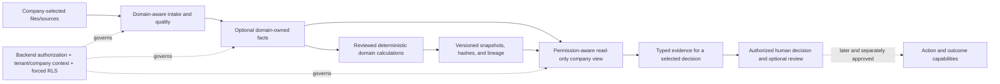

# BusinessFlow Architecture Overview

- **Status:** Current code facts, the historical M9 target direction, the separately scoped M10 synthetic demo, and the bounded M14 finance-source intake are deliberately separated. M10 remains synthetic-only; M14's entire finance-source API is disabled by default, and its unresolved finance-owner/source/access/correction/retention/independent-control gates do not authorize production accounting-data processing.
- **Product direction:** Company-wide Business Intelligence & Decision Platform; see [`product/PRODUCT_VISION.md`](product/PRODUCT_VISION.md).
- **Detailed assessment:** [`architecture/CURRENT_VS_TARGET_GAP_ANALYSIS.md`](architecture/CURRENT_VS_TARGET_GAP_ANALYSIS.md) and [`architecture/TARGET_DOMAIN_ARCHITECTURE.md`](architecture/TARGET_DOMAIN_ARCHITECTURE.md).

## 1. Current implementation

The repository contains a Python/FastAPI modular-monolith backend using SQLAlchemy, Alembic, and PostgreSQL. Migrations `0001_backend_foundation`–`0011_finance_source_intake` cover bounded M2–M8 backend slices plus M10 and M12–M14; M9 was documentation-only and M11 is a database-free calculation/verification package. Current modules include identity/tenancy, company context, staged data imports, metrics, project assessments, project decisions, project financial assessments, the synthetic-only monthly position review, the bounded company-data registry, metric comparisons, and the manual finance-source contract/intake. See [`BACKEND_IMPLEMENTATION.md`](BACKEND_IMPLEMENTATION.md), [`M12_COMPANY_DATA_INTELLIGENCE.md`](M12_COMPANY_DATA_INTELLIGENCE.md), [`M13_METRIC_INSIGHTS.md`](M13_METRIC_INSIGHTS.md), [`M14_FINANCE_SOURCE_CONTRACTS.md`](M14_FINANCE_SOURCE_CONTRACTS.md), and the source tree under `../src/businessflow/`.

Current business data is narrow: employees, tenant-owned skills, employee skill records, weekly capacity, projects, employee-project assignments, staged imports of those data types, project-scoped intake/decision/financial observations, and read-only evidence from M13/M14. M12 adds company-scoped registration of named sources that bind existing M4 imports to six versioned M4 contracts, plus quality/freshness assessments and immutable evidence snapshots; it reuses M4 storage, M5 snapshots, and M4 lineage rather than adding a second importer or copying source rows. M13 compares only three supported M5 observations with explicit evidence gates and neutral meaning. M14 adds one manual finance-specific CSV contract, explicit mapping/profile/row evidence and caller-supplied Decimal control comparison; it stores no raw row values or canonical finance facts and does not authenticate a source or independent control. Projects are one supported business domain, not the product boundary. M5 has five draft, observational non-financial metrics. M8 preserves sourced project financial observations and always reports `incomplete` without an approved financial policy. M10 remains a separate Company-scoped, synthetic-only workflow over exact built-in templates: four operational datasets, optional source-native finance rows, immutable evidence-linked briefs, and human dispositions. It can bind optional M12 ingestion evidence, but M10 remains synthetic-only. M12 reuses the existing M4 file intake for its six supported datasets and adds no separate importer, live connector, or scheduled ingestion. M14's finance-owner, source/access, correction, retention, and independent-control approvals remain unresolved; no production/customer accounting data is authorized. The backend still has no general BI layer, company-wide financial fact model, non-project decision engine, AI runtime, or permission-aware AI retrieval.

## 2. Target architectural posture

The M9 product target is a **company-wide BI & Decision Platform built incrementally from optional domain modules**, not a generic arbitrary-SQL workbench or an all-at-once enterprise schema. M10 is a separately scoped synthetic-only demonstration, not an implementation of the broad target. Preserve the modular monolith, PostgreSQL, forced RLS, backend authorization, immutable evidence/history, deterministic calculations, and human-controlled decisions. Apply **Evidence Before Answers — No evidence, no confident answer** to any future AI response. Keep self-hosted/on-prem-first deployment and cloud portability; local/on-prem AI inference is a target requirement for any separately approved AI capability, not an implemented feature. No LLM, inference runtime, or provider is selected; no new infrastructure is justified by this assessment.

This is a target flow, not a system diagram of the whole implemented platform. Current code implements the bounded M2–M8 slices, separate M10 synthetic workflow, M11 pure calculation/verification core, M12 company-data registration/evidence, M13 metric comparisons and M14 manual finance-source intake. It does not implement the general company-level read model, approved finance policy, broad domain coverage, live connectors, or AI flow shown above.

## 3. Architecture rules

- **Domain modules are optional.** Keep each enabled domain’s facts and definitions in its own bounded context. Do not force every company to adopt branches, locations, business units, departments, finance, or any other optional model.
- **Respect current company scope.** `Tenant` and `Company` are distinct, but the database enforces one company per tenant. Company-wide analysis within that company does not imply multi-company selection or group consolidation.
- **Use typed, auditable boundaries.** Services own invariants. Domain references must preserve tenant/company integrity; do not create an unchecked polymorphic `(type, id)` join. Keep imports, canonical facts, metrics, decisions, approvals, actions, and outcomes distinct.
- **Keep numerical truth deterministic.** A reviewed, versioned calculation operates on identified inputs and policy. Missing, stale, conflicting, or unapproved inputs cannot be silently defaulted. AI/LLMs are never financial-calculation truth or approval authority.
- **Evidence Before Answers.** Future AI retrieval must authorize before data access, attach source and calculation provenance, disclose assumptions/uncertainty/limitations, abstain on incomplete or unreliable evidence, and preserve input/calculation/policy/evidence versions for important assessments. No AI runtime implements these guarantees today.
- **Keep PostgreSQL and security controls central.** Backend authorization complements forced RLS, composite scope constraints, transaction-local verified context, and non-privileged runtime/migrator separation.
- **Do not over-architect.** Start with a domain-owned vertical slice in the current modular monolith and PostgreSQL. Add a warehouse, cache, semantic engine, message broker, workflow engine, or microservice only after a measured requirement and separate review.
- **Treat general UI and integrations as future choices.** M10 adds only a narrow internal synthetic-data browser walkthrough; there is no general-purpose customer frontend or live connector framework. Their data flows and security requirements must be scoped before implementation.

## 4. Product and architecture links

- [Product vision](product/PRODUCT_VISION.md)
- [Target domain architecture](architecture/TARGET_DOMAIN_ARCHITECTURE.md)
- [Current-versus-target gap analysis](architecture/CURRENT_VS_TARGET_GAP_ANALYSIS.md)
- [Financial intelligence architecture](architecture/FINANCIAL_INTELLIGENCE_ARCHITECTURE.md)
- [Product roadmap proposal](roadmap/PRODUCT_ROADMAP.md)
- [Database design and actual schema subset](DATABASE_DESIGN.md)
- [Backend implementation and tests](BACKEND_IMPLEMENTATION.md)
- [M12 company data intelligence](M12_COMPANY_DATA_INTELLIGENCE.md)
- [M13 bounded metric comparisons](M13_METRIC_INSIGHTS.md)
- [M14 finance source contract and reconciliation](M14_FINANCE_SOURCE_CONTRACTS.md)

The former project-acceptance requirements and milestone sequencing remain historical input. See [`BRD.md`](BRD.md), [`MVP_SCOPE.md`](MVP_SCOPE.md), and [`ROADMAP.md`](ROADMAP.md) for their supersession notices.
