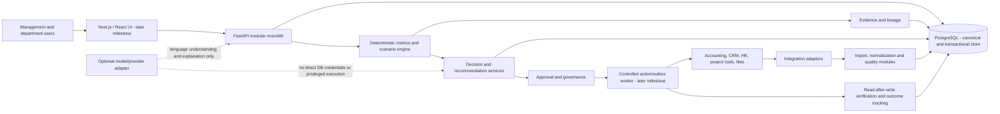

# BusinessFlow AI — Proposed System Architecture

- **Status:** Design proposal for owner review; not yet an approved implementation baseline.
- **Scope precedence:** The bounded contexts and diagrams are architectural candidates, not individual feature commitments. [`BRD.md`](BRD.md) and [`MVP_SCOPE.md`](MVP_SCOPE.md) define the current provisional release boundary.
- **Product:** BusinessFlow AI — Understand. Decide. Act. Learn.

## 1. Architectural intent

BusinessFlow AI is a business operating/decision layer over existing systems, not an ERP, accounting ledger, generic BI dashboard, document chatbot or autonomous-agent framework. The product owns its canonical business context, deterministic metrics, evidence and lineage, investigations, decision/scenario logic, approval policy and outcome evaluation.

The initial design is a **modular monolith** with a single PostgreSQL primary database. Modules have explicit service boundaries and tests, but share a deployable backend and migrations. Background work may run in a separate process using the same application package and database; this is not a premature microservice split.

## 2. System context

The diagram describes desired boundaries, not implemented integrations. The MVP begins with file imports and controlled internal workflows. A later connector must preserve the source system's identifiers, timestamps, currency, provenance and synchronization state.

## 3. Bounded contexts and ownership

| Context/module | Owns | Does not own |
|---|---|---|
| Identity and access | Authenticated principal, tenant membership, application permissions, company/department scope | Business employee/job titles; provider-specific identity credentials |
| Tenant and company | Tenant is the customer/security boundary; Company is the real business entity and operational/financial context. Separate entities, strict 1:1 in the MVP; retain tenant/company scope so a future 1:N cardinality can be added | Multi-company selection and group consolidation in the MVP; external accounting/ERP schema |
| Workforce and capacity | Employees, job roles, skills, capacity periods, resource rates and allocations | Hiring/firing decisions or payroll processing |
| Business relationships | Customers/suppliers (role-bearing parties), projects/opportunities, contracts and commitments | Replacement CRM/project-management systems |
| Financial facts | Imported revenue facts, expenses, invoices/receivables, payment receipts, cash snapshots and budgets | General ledger posting, tax accounting or bank/payment execution |
| Integrations and ingestion | Data source registration, file/API adapters, raw records, mappings, import batches and sync checkpoints | Canonical financial rules or permission decisions |
| Data quality and reconciliation | Type/required-field checks, duplicates, cross-source matching, quality findings and resolution | Silent correction of source facts |
| Metrics and evidence | Versioned metric definitions/results, formula execution, source lineage and evidence snapshots | LLM-authored numeric values or untraceable aggregates |
| Investigation and scenario | Deterministic query plans, scenario inputs/outputs, constraints and limitations | Direct database SQL from a model; arbitrary tool execution |
| Decision and recommendation | Decision case, alternatives, assumptions, expected impact, risks and recommendation | Approval, execution or claim of successful outcome |
| Approval and governance | Human actor, approval policy, exact approved option/payload, decision history | Trusting a caller-supplied approver identity |
| Action orchestration | Approved action requests, idempotency, attempts, retries and verification | Unapproved sensitive operations or autonomous high-impact actions |
| Outcome evaluation | Expected-versus-actual measures and decision-quality evidence | Retroactively rewriting the original recommendation |
| Audit and policy | Append-only business/security audit events and versioned declarative policies | Treating a database hash chain as tamper-proof against database administrators |
| Industry packs | Versioned terms, KPIs, formulas, rules, validation and decision templates | Core entity ownership or arbitrary executable code from third parties |

An industry pack is declarative/versioned and validated. Software & IT Services is the first candidate pack, not a permanent product restriction.

## 4. Data flow and trust boundaries

1. An authenticated user or scheduled connector starts an import. The backend derives `tenant_id` from verified membership; an incoming body or query parameter cannot choose a tenant.
2. The integration adapter writes source metadata and immutable raw rows (or an encrypted file reference plus row hashes) to the ingestion area.
3. Mapping and normalization produce typed normalized rows with a mapping version. Validation and reconciliation findings are persisted; unresolved or contradictory rows are not promoted as verified business facts.
4. An explicit, audited import confirmation promotes accepted records to canonical tables. Canonical records retain source references and provenance.
5. Deterministic metric/scenario services calculate values from a defined data snapshot, formula version and business-rule version. Evidence links calculations back to source records and assumptions.
6. A decision service compares supported options and may return “insufficient reliable data to make this recommendation.” An LLM may interpret a question or explain a result, but cannot invent financial facts or bypass data-quality checks.
7. A recommendation is not an approval. An authenticated human approves an immutable option/payload hash according to server-side policy. An action is not complete because it was recommended, approved or submitted.
8. The action worker records each attempt, uses idempotency and safe retries, then performs a separate verification/read-back. Outcomes are measured later against the original expected-impact snapshot.

Imported files, documents, connector responses and user-supplied instructions are untrusted input. Retrieval or model prompts must not treat embedded instructions as privileged policy. Any future model tool is a narrow backend function that repeats authorization and tenant checks; the model never receives database credentials.

## 5. Proposed technical baseline

The specific review-date versions, compatibility metadata, license observations, operations, product fit and alternatives are in [`TECHNICAL_BASELINE_PROPOSAL.md`](TECHNICAL_BASELINE_PROPOSAL.md). It proposes CPython/FastAPI, PostgreSQL, SQLAlchemy/Alembic, Next.js/React/TypeScript, Keycloak/Authlib, a PostgreSQL outbox, private local-file storage, pytest/Playwright, and one-host OCI/Compose packaging.

**These exact components and versions are recommendations only, not owner-approved or implemented.** PostgreSQL remains a technical recommendation, not an owner-confirmed technology choice. Owner-confirmed directions remain: self-hosted/on-prem first with cloud portability, hybrid identity requirements, and distinct `Tenant`/`Company` with strict 1:1 MVP cardinality. No dependency is installed. Any future implementation requires an owner-approved lock, transitive license/security review, compatibility build, and real PostgreSQL tests; SQLite cannot substitute for RLS tests.

## 6. API and module boundaries

- Proposed API: versioned REST `/api/v1`, OpenAPI, Pydantic request/response schemas and stable error envelopes. No GraphQL, arbitrary SQL, or raw warehouse access in the MVP.
- Proposed request path: same-origin UI/BFF to FastAPI; resolve identity, active membership, company/object scope and permissions before calling the application service. Tenant context is bound to the PostgreSQL transaction from the verified membership.
- Keep routers thin. Domain services enforce invariants regardless of route/worker entry point; modules use service interfaces and tenant-scoped repositories.
- Use `Decimal`/PostgreSQL `NUMERIC`, formula versions, immutable inputs and structured validation results. Missing inputs produce an explicit abstention, not a silent default.
- Use idempotency keys for imports and actions. A `202` response is not proof of completion; attempts, verification and outcome are separate states.
- Use reviewed migrations only after owner approval; production startup never silently creates or mutates schema.
- Version and technology choices remain recommendations in `TECHNICAL_BASELINE_PROPOSAL.md`, not implementation authorization.

## 7. Integration boundaries

Each connector implements a narrow inbound/outbound port with a versioned mapping and a least-privilege credential. Inbound adapters may read external systems and stage data. Outbound adapters are only reachable through the approved action execution service. Secrets are stored in an environment/managed secret facility or an encrypted credential store; never in source, prompts, logs or ordinary JSON settings.

Initial delivery order: CSV/XLSX import foundation → canonical mappings/reconciliation → read-only source connections if needed → one controlled project/work-item action after approvals. No direct payments, bank transfers, hiring, firing or other high-impact irreversible execution in the initial release.

## 8. Explicit non-goals for the foundation

- Microservices, Kafka, Kubernetes, Redis, Temporal, a generic agent framework, an LLM-driven SQL endpoint, or autonomous actions.
- Replacing accounting, ERP, CRM, HR, payroll or project-management systems.
- Shipping every industry pack or every dashboard/workspace before the data model and first decision flow are validated.
- Claiming RLS, an audit hash chain, signed tickets, a model “confidence score,” or an HTTP success response alone proves isolation, truth, approval or execution.

The proposed project-acceptance input/abstention/calculation contract and reversible first action are in [`MVP_DECISION_MODEL.md`](MVP_DECISION_MODEL.md); entity status, ownership, keys and tenant/company integrity are in [`MVP_ENTITY_CATALOG.md`](MVP_ENTITY_CATALOG.md). These are proposals, not an approved feature scope or implementation plan.

## 9. Owner decisions and architecture records

The owner confirmed separate `Tenant` and `Company` entities with strict 1:1 MVP cardinality, self-hosted/on-prem-first deployment with future cloud portability, and hybrid first-party plus OIDC/enterprise identity with proper MFA and account/session controls. The overall assessment remains in review; no Milestone 0 or implementation is approved. Detailed identity controls are in [`IDENTITY_AND_AUTHORIZATION.md`](IDENTITY_AND_AUTHORIZATION.md), deployment concerns in [`DEPLOYMENT_ARCHITECTURE.md`](DEPLOYMENT_ARCHITECTURE.md), AI boundaries in [`AI_GOVERNANCE.md`](AI_GOVERNANCE.md), and proposed ADRs in [`adr/`](adr/). Exact platform, tenancy-per-installation, identity provider/lifecycle, residency, retention, deletion, compensation visibility, currency conversion and approval thresholds remain explicit gates.
