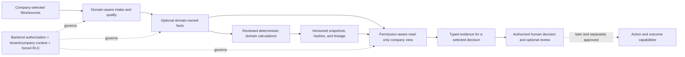

# BusinessFlow Architecture Overview

- **Status:** Current code facts and M9 target direction are deliberately separated. The target is a proposal, not an implemented platform or authorization for more code.
- **Product direction:** Company-wide Business Intelligence & Decision Platform; see [`product/PRODUCT_VISION.md`](product/PRODUCT_VISION.md).
- **Detailed assessment:** [`architecture/CURRENT_VS_TARGET_GAP_ANALYSIS.md`](architecture/CURRENT_VS_TARGET_GAP_ANALYSIS.md) and [`architecture/TARGET_DOMAIN_ARCHITECTURE.md`](architecture/TARGET_DOMAIN_ARCHITECTURE.md).

## 1. Current implementation

The repository contains a Python/FastAPI modular-monolith backend using SQLAlchemy, Alembic, and PostgreSQL. Migrations `0001_backend_foundation`–`0007_financial_feasibility` map to bounded M2–M8 backend slices. Current modules include identity/tenancy, company context, staged data imports, metrics, project assessments, project decisions, and project financial assessments. See [`BACKEND_IMPLEMENTATION.md`](BACKEND_IMPLEMENTATION.md) and the source tree under `../src/businessflow/`.

Current business data is narrow: employees, tenant-owned skills, employee skill records, weekly capacity, projects, employee-project assignments, staged imports of those data types, and project-scoped intake/decision/financial observations. Projects are one supported business domain, not the product boundary. M5 has five draft, observational non-financial metrics. M8 preserves sourced project financial observations and always reports `incomplete` without an approved financial policy. The reviewed backend contains no general-purpose BI layer, company-wide financial fact model, frontend, live connector framework, non-project decision engine, AI runtime, or permission-aware AI retrieval.

## 2. Target architectural posture

The M9 target is a **company-wide BI & Decision Platform built incrementally from optional domain modules**, not a generic arbitrary-SQL workbench or an all-at-once enterprise schema. Preserve the modular monolith, PostgreSQL, forced RLS, backend authorization, immutable evidence/history, deterministic calculations, and human-controlled decisions. Apply **Evidence Before Answers — No evidence, no confident answer** to any future AI response. Keep self-hosted/on-prem-first deployment and cloud portability; local/on-prem AI inference is a target requirement for any separately approved AI capability, not an implemented feature. No LLM, inference runtime, or provider is selected; no new infrastructure is justified by this assessment.

This is a target flow, not a system diagram of implemented features. Current code implements the bounded staging, domain records, M5 runs, M6 capacity comparison, M7 project decision/approval, and M8 project financial observation portions only.

## 3. Architecture rules

- **Domain modules are optional.** Keep each enabled domain’s facts and definitions in its own bounded context. Do not force every company to adopt branches, locations, business units, departments, finance, or any other optional model.
- **Respect current company scope.** `Tenant` and `Company` are distinct, but the database enforces one company per tenant. Company-wide analysis within that company does not imply multi-company selection or group consolidation.
- **Use typed, auditable boundaries.** Services own invariants. Domain references must preserve tenant/company integrity; do not create an unchecked polymorphic `(type, id)` join. Keep imports, canonical facts, metrics, decisions, approvals, actions, and outcomes distinct.
- **Keep numerical truth deterministic.** A reviewed, versioned calculation operates on identified inputs and policy. Missing, stale, conflicting, or unapproved inputs cannot be silently defaulted. AI/LLMs are never financial-calculation truth or approval authority.
- **Evidence Before Answers.** Future AI retrieval must authorize before data access, attach source and calculation provenance, disclose assumptions/uncertainty/limitations, abstain on incomplete or unreliable evidence, and preserve input/calculation/policy/evidence versions for important assessments. No AI runtime implements these guarantees today.
- **Keep PostgreSQL and security controls central.** Backend authorization complements forced RLS, composite scope constraints, transaction-local verified context, and non-privileged runtime/migrator separation.
- **Do not over-architect.** Start with a domain-owned vertical slice in the current modular monolith and PostgreSQL. Add a warehouse, cache, semantic engine, message broker, workflow engine, or microservice only after a measured requirement and separate review.
- **Treat UI and integrations as future choices.** The current backend has no frontend or general live connector framework. Their data flows and security requirements must be scoped before implementation.

## 4. Product and architecture links

- [Product vision](product/PRODUCT_VISION.md)
- [Target domain architecture](architecture/TARGET_DOMAIN_ARCHITECTURE.md)
- [Current-versus-target gap analysis](architecture/CURRENT_VS_TARGET_GAP_ANALYSIS.md)
- [Financial intelligence architecture](architecture/FINANCIAL_INTELLIGENCE_ARCHITECTURE.md)
- [Product roadmap proposal](roadmap/PRODUCT_ROADMAP.md)
- [Database design and actual schema subset](DATABASE_DESIGN.md)
- [Backend implementation and tests](BACKEND_IMPLEMENTATION.md)

The former project-acceptance requirements and milestone sequencing remain historical input. See [`BRD.md`](BRD.md), [`MVP_SCOPE.md`](MVP_SCOPE.md), and [`ROADMAP.md`](ROADMAP.md) for their supersession notices.
