# BusinessFlow AI — Database Design Proposal and Implemented Subset

- **Status:** The ERD and broad table catalog remain logical proposals. The bounded backend has Alembic migrations `0001_backend_foundation`, `0002_company_context`, and `0003_staged_data_imports`; this is not a claim that the full proposed production schema is implemented.
- **Primary store:** The authorized M2/M3 backend and bounded M4 import slice use PostgreSQL; the M4 migration/integration suite has been exercised locally on PostgreSQL 16.2, while project Compose/CI targets PostgreSQL 18. This does not approve every technology choice in the broader proposal or establish production architecture.
- **Scope precedence:** Table groups and entities below are schema candidates, not a promise that every capability is in the core release. [`BRD.md`](BRD.md) and [`MVP_SCOPE.md`](MVP_SCOPE.md) govern business priority; optional cash, action and outcome entities do not make those features Must Have.
- **Design goal:** Multi-tenant canonical business facts and traceable decisions without replacing a customer's book-of-record.

## 1. Logical ERD

The diagram is logical, not a migration contract. `tenant_id` is omitted from many diagram nodes for legibility; every Tenant-owned business row carries it, while the `tenant` root table uses its own `id` as the isolation key (no redundant `tenant_id`). Global identity/permission catalogs are the other limited exceptions described below. The backend foundation enforces `Tenant` and `Company` as separate entities with exactly one company per tenant: a unique company-per-tenant constraint plus a deferred tenant-to-company reference enforces the 1:1 pair at transaction commit. PostgreSQL validates this implementation and M3 adds company-scoped tables that preserve the same tenant/company pairing. The 1:1 is an MVP cardinality constraint, not a permanent domain limitation; expanding it remains a future, separately approved migration.

```mermaid
erDiagram
    TENANT ||--|| COMPANY : owns
    TENANT ||--o{ TENANT_MEMBERSHIP : grants
    USER_ACCOUNT ||--o{ TENANT_MEMBERSHIP : joins
    TENANT_MEMBERSHIP ||--o{ MEMBERSHIP_ROLE : receives
    ACCESS_ROLE ||--o{ MEMBERSHIP_ROLE : assigned
    ACCESS_ROLE ||--o{ ROLE_PERMISSION : grants
    PERMISSION ||--o{ ROLE_PERMISSION : names

    COMPANY ||--o{ BUSINESS_UNIT : organizes
    BUSINESS_UNIT ||--o{ DEPARTMENT : contains
    DEPARTMENT ||--o{ EMPLOYEE : staffs
    JOB_ROLE ||--o{ EMPLOYEE : classifies
    EMPLOYEE ||--o| BUSINESS_RESOURCE : represents
    BUSINESS_RESOURCE ||--o{ RESOURCE_CAPACITY : has

    COMPANY ||--o{ BUSINESS_PARTY : records
    BUSINESS_PARTY ||--o{ PARTY_ROLE : plays
    COMPANY ||--o{ CONTRACT : records
    COMPANY ||--o{ PROJECT : owns
    BUSINESS_PARTY ||--o{ PROJECT : customer
    PROJECT ||--o{ PROJECT_CONTRACT : governed_by
    CONTRACT ||--o{ PROJECT_CONTRACT : covers
    PROJECT ||--o{ RESOURCE_ALLOCATION : needs
    BUSINESS_RESOURCE ||--o{ RESOURCE_ALLOCATION : allocated
    PROJECT ||--o{ TIME_ENTRY : records
    EMPLOYEE ||--o{ TIME_ENTRY : submits
    PROJECT ||--o{ REVENUE_FACT : earns
    PROJECT ||--o{ PROJECT_EXPENSE : incurs

    COMPANY ||--o{ INVOICE : issues_or_imports
    INVOICE ||--o{ INVOICE_LINE : contains
    PROJECT ||--o{ INVOICE_LINE : billed_for
    INVOICE ||--o{ PAYMENT_RECEIPT : settled_by
    COMPANY ||--o{ CASH_POSITION : observes
    COMPANY ||--o{ COMMITMENT : records
    PROJECT ||--o{ COMMITMENT : consumes
    COMPANY ||--o{ BUDGET : plans
    BUDGET ||--o{ BUDGET_LINE : allocates
    KPI_DEFINITION ||--o{ KPI_OBSERVATION : calculates
    COMPANY ||--o{ KPI_OBSERVATION : scopes
    GOAL ||--o{ GOAL_KPI : measures
    KPI_DEFINITION ||--o{ GOAL_KPI : targets
    COMPANY ||--o{ BUSINESS_RISK : tracks

    TENANT ||--o{ DATA_SOURCE : configures
    DATA_SOURCE ||--o{ IMPORT_BATCH : feeds
    IMPORT_BATCH ||--o{ RAW_RECORD : captures
    RAW_RECORD ||--o{ NORMALIZED_RECORD : normalizes
    NORMALIZED_RECORD ||--o{ SOURCE_ENTITY_LINK : maps
    SOURCE_ENTITY_LINK ||--o{ DATA_LINEAGE : supports
    COMPANY ||--o{ BUSINESS_EVENT : records
    TENANT ||--o{ POLICY : governs
    TENANT ||--o{ AUDIT_EVENT : audits

    COMPANY ||--o{ DECISION_CASE : considers
    DECISION_CASE ||--o{ DECISION_SUBJECT : concerns
    DECISION_CASE ||--o{ RECOMMENDATION : versions
    RECOMMENDATION ||--o{ RECOMMENDATION_OPTION : compares
    RECOMMENDATION ||--o{ RECOMMENDATION_EVIDENCE : cites
    EVIDENCE ||--o{ RECOMMENDATION_EVIDENCE : supports
    EVIDENCE ||--o{ DATA_LINEAGE : traces
    DECISION_CASE ||--o{ APPROVAL_REQUEST : requests
    APPROVAL_REQUEST ||--o{ APPROVAL_DECISION : receives
    APPROVAL_REQUEST ||--o{ ACTION : authorizes
    ACTION ||--o{ ACTION_ATTEMPT : attempts
    ACTION ||--o{ ACTION_VERIFICATION : verifies
    DECISION_CASE ||--o{ OUTCOME_MEASUREMENT : measures
    ACTION ||--o{ OUTCOME_MEASUREMENT : contributes
```

`DECISION_SUBJECT` and `SOURCE_ENTITY_LINK` are typed links to canonical entities. A generic `(entity_type, entity_id)` association cannot be made a normal foreign key to every entity table; it must use a strict enum/allow-list, same-tenant validation, integrity tests and deletion rules. If that becomes too risky or joins become hot, replace it with typed link tables for the small set of supported subjects.

The ERD shows the MVP 1:1 constraint. The domain keeps tenant-scoped facts and explicit company-scoped facts separate so a future, separately approved change can expand to one tenant / many companies without replacing core fact tables. Multi-company selection and group-level consolidation are not represented or enabled here. Consolidation will require explicit deterministic rules for currency/FX, ownership/effective dates, fiscal periods and intercompany eliminations; it must not be implemented as an unreviewed sum across companies.

## 2. Canonical entity/table groups

| Group | Proposed tables (not all in the first migration) |
|---|---|
| Tenant and identity | `tenant` (including MVP `primary_company_id` if using the deferred-FK 1:1 pattern), `user_account` / identity subject, `tenant_membership`, `access_role`, `permission`, `role_permission`, `membership_role` |
| Company/organization | `company`, `business_unit`, `department`, `job_role`, `employee`, `skill`, `employee_skill`, `business_resource`, `resource_capacity`, `resource_rate` |
| Business relationships | `business_party`, `party_role`, `project`, `contract`, `project_contract`, `resource_allocation`, `time_entry` |
| Financial facts | `revenue_fact`, `project_expense`, `invoice`, `invoice_line`, `payment_receipt`, `cash_position`, `budget`, `budget_line`, `commitment` |
| Management context | `goal`, `goal_kpi`, `kpi_definition`, `kpi_observation`, `business_risk`, `business_event`, `policy` |
| Ingestion and lineage | `data_source`, `import_batch`, `raw_record`, `normalized_record`, `source_entity_link`, `data_lineage`, `evidence` |
| Decision and governance | `decision_case`, `decision_subject`, `recommendation`, `recommendation_option`, `recommendation_evidence`, `approval_request`, `approval_decision`, `action`, `action_attempt`, `action_verification`, `outcome_measurement` |
| Audit | `audit_event` (separate from business events and mutable operational state) |

### Implemented M2–M4 subset

The implemented schema is intentionally smaller than the table catalog above. `0001_backend_foundation` creates users, authentication sessions/tokens/throttles, tenants, the one primary company, memberships, onboarding idempotency records and audit events. `0002_company_context` creates `business_units`, `departments`, `employees`, `skills`, `employee_skills`, `employee_weekly_capacity`, `projects` and `resource_assignments`. `0003_staged_data_imports` creates `data_imports`, `data_import_rows`, and `data_import_record_links` for tenant/company-scoped staged file imports and source-to-canonical traceability. All newly added tenant-owned tables use forced RLS; company-scoped rows and import data use composite tenant/company foreign keys. Skills use tenant scope. Weekly capacity versions preserve history; staged payload values are cleared on apply, cancellation, or expiry while import metadata, row hashes, issues, audit events, and trace links remain.

Global lookup catalogs (for example, the permission catalog or currency metadata) need not be tenant-owned. Policies, decisions, approvals, actions and outcomes remain logical candidates and are not part of these migrations. The M4 import migration is implemented in the branch; its clean live upgrade and model drift check passed on PostgreSQL 16.2. Verification against the PostgreSQL 18 CI target remains pending.

## 3. Keys, references and constraints

- Use UUID primary keys. IDs are not authorization; every read/write still checks tenant and object scope.
- Every tenant-owned row has `tenant_id NOT NULL`; company-specific facts also have `company_id NOT NULL` where appropriate.
- Parent tables expose `UNIQUE (tenant_id, id)` to support composite foreign keys. For company-specific rows, use `(tenant_id, company_id) REFERENCES company (tenant_id, id)`; for other tenant-owned references, include `tenant_id` in the foreign key. This prevents a valid ID from another tenant being attached by mistake.
- Enforce the strict MVP 1:1 at the database boundary, not only in onboarding code. Proposed pattern: `company.tenant_id NOT NULL UNIQUE` references `tenant.id`; `tenant.primary_company_id NOT NULL` plus a deferred composite FK `(tenant.id, tenant.primary_company_id) REFERENCES company (tenant_id, id)` ensures the tenant points to its own company. Create both rows in one transaction with the circular constraints deferred to commit. A deferred constraint trigger is an alternative only if the migration/ORM design rejects the FK pattern; both variants must pass PostgreSQL invariant tests. Scope other natural uniqueness by tenant/company, e.g. `(tenant_id, data_source_id, external_id)`, `(tenant_id, company_id, project_code)` and `(tenant_id, membership_id, role_id, scope_type, scope_id)`.
- Unique external identifiers are scoped by data source; never assume two external systems share an identifier namespace.
- Money uses PostgreSQL `NUMERIC` and Python `Decimal`, paired with an explicit three-letter currency code. Preserve source currency and amount; conversions require dated, attributable FX rates and an approved rate source.
- Use `DATE` for business dates and `TIMESTAMPTZ` for instants; store/interpret company timezone explicitly. Avoid string dates and floating-point for business facts.
- Required status/state values use constrained enums or validated reference tables. Cross-field invariants (e.g. one recommended option per recommendation version; one active source mapping) use database constraints/unique partial indexes where possible.
- JSONB is for source payloads, extensible metadata and validated rule configuration—not as a substitute for canonical columns, financial formulas or authorization rules.

## 4. Tenant isolation and authorization

1. Authentication resolves a principal and memberships. The user selects a tenant only from memberships the backend has verified. The tenant ID is not trusted from request JSON, URL alone, model output or import content.
2. Every request/service starts a transaction and binds `app.tenant_id` transaction-locally (`SET LOCAL` or `set_config(..., true)`) from the verified principal. Background jobs load tenant identity from a trusted, persisted job row and bind it before querying.
3. Enable and `FORCE ROW LEVEL SECURITY` on tenant-owned tables. Where the `tenant` anchor table is in the runtime role, its policy constrains `tenant.id` to the verified transaction tenant; child-table policies use `tenant_id`. Policies fail closed when the tenant setting is absent. The runtime application role is not the table owner and has no `BYPASSRLS`; migrations use a separate privileged role.
4. Application authorization is still mandatory: verify membership, permission, company/department scope, object ownership and sensitive-data rights before service calls. RLS is defense in depth, not a substitute for service authorization.
5. Keep tenant context inside the transaction so pooled connections cannot retain another tenant's scope. Do not provide a general application `SET ROLE` or bypass flag.
6. Any system-wide maintenance/admin operation uses a narrow, audited, separately authorized path. Do not expose an ordinary “skip RLS” application mode.

**Required isolation tests:** run against PostgreSQL and exercise read, insert, update, delete, joins, foreign keys, conflict/upsert paths, background jobs, connection-pool reuse, missing tenant context, object-ID guessing, and privileged/admin behavior across two tenants. Include company-scope and department/compensation permissions. SQLite cannot validate PostgreSQL RLS semantics. The implemented M3 integration suite covers forced RLS on all eight new tables, missing context, two-tenant pooled-connection reuse, wrong-tenant writes, same-tenant/company composite-FK rejection, and restricted runtime grants; future tables and background jobs need their own coverage.

## 5. Company and organization hierarchy

`tenant` → exactly one `company` in the implemented MVP foundation. Provision them together. Multiple companies and consolidated reporting are not supported within a tenant; a future migration may expand the cardinality while retaining company-scoped facts. The M3 organization hierarchy is `business_unit` → `department` → `employee`; a department has at most one optional business-unit reference. Nested departments, manager relationships, a `job_role` catalog, and generic `business_resource` records are not implemented. The Employee model stores a job-title string and is separate from `UserAccount`; employees do not need login access. `access_role` remains the product-permission role, not a business job title.

Compensation and cost-rate data are more restricted than general employee/resource capacity. The initial permission catalog must distinguish `workforce:capacity:read` from `workforce:compensation:read` and log sensitive reads.

## 6. User, role and permission model

- `user_account` identifies an external OIDC subject (`issuer`, `subject`); email is profile data and not a universal identity key.
- `tenant_membership` represents access to a tenant. `membership_role` grants one or more `access_role` values, optionally scoped to a company (department scope may be enabled when a real workflow requires it).
- Roles map to explicit permission codes such as `company:read`, `project:write`, `finance:read`, `workforce:compensation:read`, `decision:recommend`, `decision:approve` and `action:execute`.
- Permissions are checked in the backend for every request and every background action. Approval roles are not inferred from a frontend route or model response.
- Sensitive actions use separation of duties where policy requires it; the approver is the authenticated actor. A request cannot self-declare its own approver.

The owner confirmed hybrid production identity: OIDC/enterprise SSO plus a first-party account path, with proper MFA, account linking, recovery, session management and authorization policies. Specific providers, factors, lifetimes, bootstrap and account-linking rules remain subject to the identity design and approval before implementation.

## 7. Audit, events and decisions

### Audit

`audit_event` is append-only through application permissions and records tenant, actor type/ID, action, target, timestamp, request/correlation ID, outcome and redacted metadata. Do not write secrets, full imported documents or unnecessary personal data to logs. Hashes may help detect accidental changes but a hash chain stored in the same mutable database is not an immutable external audit system.

### Business events

`business_event` represents typed operational facts and may be imported (e.g. timesheet approved). It is not the same as the security/audit log and does not imply a trusted actor performed a BusinessFlow action.

### Decision and recommendation

`decision_case` records the question, company, type, subject links and a decision-input snapshot. `recommendation` is versioned and stores calculation/rule versions, evidence references, assumptions, limitations, risks, alternatives and impact. Each `recommendation_option` carries its own scenario inputs/results and source lineage. Do not store a vague model confidence percentage as a substitute for data quality.

### Approval, action and outcome lifecycle

- `approval_request` points to an exact recommendation version/option or action payload hash and applicable policy version.
- `approval_decision` appends approve/reject/revise decisions with authenticated actor, timestamp and reason. Changes to the approved option/payload invalidate the prior authorization.
- `action` stores target connector/system, immutable payload hash, idempotency key and lifecycle state (`proposed`, `pending_approval`, `approved`, `queued`, `attempting`, `submitted`, `completed`, `failed`, `verified`, `cancelled` as applicable).
- `action_attempt` records each execution and retry separately, including sanitized request/result metadata and failure code.
- `action_verification` records an independent read-back/check. Only this can establish the `verified` state.
- `outcome_measurement` stores expected versus actual values, measurement period, calculation version, evidence and variance. It does not rewrite the original recommendation.

These are distinct records/states. A recommendation cannot be represented as an approval, and a successful API submission cannot be represented as a verified business outcome.

## 8. Data sources, imports and raw/normalized/canonical separation

- `data_source`: tenant, optional company scope, connector/file type, external account identifier, credential reference (not secret), sync configuration version, enabled state and last-sync metadata.
- `import_batch`: tenant, source, actor/system, file/source metadata, mapping version, content hash, lifecycle state, counts, validation/reconciliation summary and timestamps. Use idempotency and duplicate detection.
- `raw_record`: immutable row/event payload as received, source key, row number/cursor, observed time and checksum. Raw records remain untrusted.
- `normalized_record`: typed normalized payload, mapping version, validation state and error list. Normalization is repeatable; it does not silently overwrite the original raw record.
- `source_entity_link`: maps an external record to a canonical entity and retains the external key/version. Enforce tenant consistency and uniqueness by source.
- `data_lineage`: records the chain of source records, mapping/transform version and metric/calculation run that contributed to a derived value or evidence item.
- Promotion into canonical entities is an explicit confirmation/service operation. Reconciliation disputes remain visible and block calculations that require the disputed data.

Original files, if retained, live in an encrypted object store/file adapter with a checksum and retention policy; do not put unbounded file blobs in the transactional DB. Storage provider and retention period are pending deployment/legal decisions.

## 9. KPI, metric and financial calculation model

`kpi_definition` includes a stable key, name/description, unit, applicable dimensions, formula or calculation identifier, version, effective range, input requirements, owner and review status. Formulas execute through reviewed deterministic code or a constrained validated DSL—not arbitrary LLM-generated SQL/Python. `kpi_observation` stores company/scope, period, exact value, currency/unit, formula version, input snapshot, data-quality status and lineage.

For project acceptance, exact formulas for realized/expected revenue, direct/indirect cost, utilization, expected margin, cash collection and risk are intentionally not frozen here. They require product/accounting review, source-data mapping and golden test cases. Missing required data must reduce scope or return insufficient data; never fill it with an unlabelled default.

## 10. Indexing and query shape

Initial index strategy (confirm with query plans after representative data exists):

- B-tree indexes on tenant-scoped foreign keys and common selectors: `(tenant_id, company_id, status)`, `(tenant_id, project_id, work_date)`, `(tenant_id, resource_id, period_start)`, `(tenant_id, company_id, due_date)` and `(tenant_id, source_id, external_id)`.
- Partial indexes for pending approvals/actions and unprocessed import batches.
- Composite indexes aligned to chronological queries; avoid indexing every JSONB field.
- Unique indexes on tenant-scoped business identifiers and idempotency keys.
- Add GIN/JSONB, full-text or vector indexes only after a measured query/retrieval need and access-control design.
- Store company and tenant predicates explicitly even when RLS is enabled so plans and service intent remain clear.

## 11. Migration and rollout strategy

- Use version-controlled Alembic migrations; every schema change has a migration and review.
- Revisions `0001_backend_foundation`, `0002_company_context`, and `0003_staged_data_imports` are version-controlled Alembic migrations. The M3 populated-M2 upgrade test verifies tenant/company/membership preservation at head. A clean upgrade through M4 and `alembic check` passed against PostgreSQL 16.2; the full suite also covers the populated upgrade path. CI against the project's PostgreSQL 18 target remains pending. No production `create_all`, schema push, or manual DDL is used.
- Runtime and migration roles are separate. Production deployments use expand/backfill/contract steps for incompatible changes; migration rollback policy is documented per change rather than assuming every data migration is reversible.
- Seed only stable reference catalogs in production. Realistic example data is test-only and cannot masquerade as customer analytics.
- Before enabling a new RLS table, migration tests prove policy coverage, forced RLS and runtime role behavior. M3 tests cover its eight tables; M4 tests cover forced RLS and least-privilege grants on the three import tables. The complete database-backed suite passed locally on PostgreSQL 16.2; PostgreSQL 18 CI is pending.

## 12. Retention, deletion and privacy

No legal jurisdiction or retention duration is specified, so this proposal does not invent one. Before production, decide retention by data class (original files, raw/normalized rows, canonical financial facts, employee/compensation data, audit records, model prompts and backups), customer export/deletion process, legal holds and backup expiry.

Design requirements: minimize collected personal data; separate compensation access; redact logs; support tenant export; use a deletion/tombstone workflow rather than blindly cascading audit history; delete or anonymize source payloads when legally required while preserving only permitted audit metadata; record purge progress; document backup deletion latency. Financial and audit retention must be a legal/product policy, not an accidental FK cascade.

## 13. Expanded MVP-level entity catalog

[`MVP_ENTITY_CATALOG.md`](MVP_ENTITY_CATALOG.md) supplements this logical ERD with an entity-by-entity MVP/deferred status, ownership boundary, UUID/composite primary key convention, important foreign keys, tenant/company isolation, uniqueness and integrity constraints. It adds the identity/session/recovery lifecycle, immutable mapping/normalization/reconciliation versions, metric/calculation versions, scenario and evidence snapshots, and the internal follow-up task action.

This catalog remains logical and is not the DDL contract for the implemented subset. The one-Company-per-Tenant deferred-FK scheme has been implemented and validated in the M2 PostgreSQL migration. M3's implemented schema is defined by `0002_company_context`, and the bounded M4 import tables by `0003_staged_data_imports`; M4 clean upgrade, forced-RLS/runtime grants, and Alembic drift checks passed against a live PostgreSQL 16.2 test database. PostgreSQL 18 CI verification remains pending. Broader catalog entities still require their own approved schema design, migrations and security acceptance tests.
