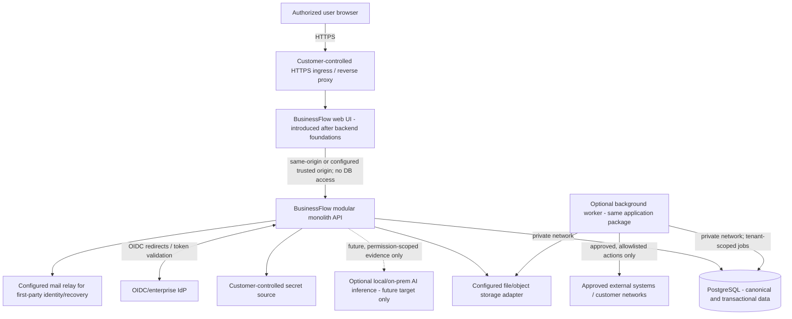

# BusinessFlow AI — Self-Hosted-First Deployment Architecture

- **Status:** Production deployment and operating procedures remain a proposal. The repository contains a Dockerfile and Docker Compose development/test baseline for the API and PostgreSQL; these are not production deployment approval. No AI inference runtime is implemented.
- **Owner-confirmed direction:** Self-hosted/on-prem first, with architecture portability so cloud hosting can be supported later without major domain redesign. For any separately approved AI feature, customer-controlled local/on-prem inference is a target architectural requirement, not a current capability.
- **Open:** Reference platform/package, network and air-gap requirements, tenant-per-installation topology, customer/operator responsibilities, storage/secrets/backup services, and production sizing/support.

## 1. Objectives and non-goals

The initial release must be operable in a customer-controlled environment, protect business/employee/financial data at the customer boundary, provide documented installation/upgrade/backup procedures and avoid hard-coupling business logic to a cloud provider. A later cloud deployment should use the same domain/application modules and standard interfaces.

This direction does **not** approve Kubernetes, Docker, a particular Linux distribution, a managed cloud service, a provider-specific database, a secrets product, or air-gapped operation. Do not build multiple deployment targets before one reference environment and operator responsibilities are accepted.

## 2. Proposed logical topology

The diagram is logical. It does not mandate separate hosts/processes for web/API/worker or a particular reverse proxy. Browser code never connects directly to PostgreSQL, storage credentials or another service via `localhost`; browser-to-application calls use a configured same-origin or explicitly trusted HTTPS origin.

## 3. Deployment boundary and operating model

### 3.1 Components and trust boundaries

- **Application:** One modular-monolith codebase and versioned artifact. HTTP APIs and background work call the same authorization/domain services; a worker may be a separately supervised process, not a separate microservice architecture.
- **Database:** PostgreSQL is the canonical and transactional store. Keep it on a private/customer-controlled network and unavailable to untrusted public clients. Use separate runtime and migration credentials, tenant RLS and verified backups.
- **File/object storage:** A narrow adapter for source files and large payloads; storage encryption, permissions, retention, backup and purge behavior are operator-configured and tested. Do not assume local filesystem/object-store semantics are interchangeable without tests.
- **Secrets:** A defined secret-provider boundary for DB, OIDC, SMTP and connector credentials. Store references/metadata in the application database, not raw secrets. Do not print secrets or authentication artifacts to logs.
- **Identity:** First-party authentication plus OIDC/enterprise SSO as defined in [`IDENTITY_AND_AUTHORIZATION.md`](IDENTITY_AND_AUTHORIZATION.md). The customer-operated environment may need outbound access to an IdP, mail relay, update channel or approved connectors; whether any deployment must be air-gapped remains open.
- **AI inference (future target, not implemented):** Any AI capability approved later must support customer-controlled local/on-prem inference. The application must authorize and retrieve only evidence the requesting user may access before sending any context to inference. An external model service is never a required dependency. No model, provider, or inference runtime is selected.
- **Integrations:** Outbound connectors are disabled by default and enabled with least-privilege credentials, approved network destinations, tenant scope, idempotency and verification.

### 3.2 Packaging and reference environment

A small supported deployment is preferred over premature orchestration: application/API, PostgreSQL, configured file storage, identity service, secret provisioning, and an optional worker, behind a customer-controlled TLS boundary. **Recommendation for owner review:** one Linux-host reference profile using OCI images and Docker Compose plugin 5.8.0 with Docker/Moby Engine 29.10.0, versions observed as stable upstream releases on 2026-11-21. This is not a deployment configuration or owner approval. Kubernetes, Kafka, Redis, Temporal and managed cloud dependencies remain out of the foundation proposal.

Before implementation, define one supported environment including Linux distribution, CPU/memory/storage minimums, ports, DNS/TLS, outbound access, PostgreSQL support policy, storage encryption and paths, Keycloak/Authlib configuration, secret injection, monitoring and log retention. A customer-operated deployment needs an explicit support matrix and upgrade/rollback policy; “self-hosted” alone does not define these. The OS, production package ownership, identity-provider topology, and customer/operator responsibilities remain open.

### 3.3 Installation tenant topology

Logical data isolation is per `Tenant`; the MVP maps one `Company` to each tenant. It remains undecided whether an installation serves one tenant or multiple tenants. Do not equate “one self-hosted installation” with “one tenant” or “multiple customers on one instance” until that operational/security decision is approved. The application must not rely on database/schema-per-customer unless a separately reviewed design selects it.

### 3.4 Proposed storage and identity service boundary

For the initial self-hosted slice, recommend a bounded private POSIX filesystem volume for imported originals behind a `BlobStore` adapter. Keep checksums, opaque object IDs, size/type limits and metadata in BusinessFlow; do not store unbounded files in PostgreSQL. Use an operator-managed encrypted volume and test backup, restore, quota, cleanup and purge behavior. This does not select an OS encryption/key product or assert encryption is implemented. A customer-provided or cloud S3-compatible backend may be added behind the adapter only after semantics and operating responsibilities are tested.

The proposed Keycloak identity service and Authlib OIDC integration are separate components with their own state, secrets, SMTP/outbound IdP access, upgrade schedule and backup/restore. BusinessFlow authorization remains authoritative. These remain unapproved recommendations; see `TECHNICAL_BASELINE_PROPOSAL.md`.

### 3.5 Multipart request-body limits at ingress

The application enforces route-specific complete-body caps for these multipart upload endpoints:

- M4 imports (`POST /api/v1/tenants/{tenant_id}/imports`) and M10 financial imports (`POST /api/v1/tenants/{tenant_id}/position-reviews/financial-imports`): `IMPORT_MAX_FILE_BYTES + 64 KiB`.
- M14 finance-source intake (`POST /api/v1/tenants/{tenant_id}/finance-sources/intakes`): `IMPORT_MAX_FILE_BYTES + 1 MiB` of metadata plus `64 KiB` of multipart framing. M14 remains disabled by default and subject to its existing operator gate.

The limits include multipart overhead; the service-level per-file checks remain defense in depth. A single declared `Content-Length` above the route limit is rejected before the application reads the body or invokes Starlette's parser. When `Content-Length` is missing, invalid, duplicated, or understated, the middleware counts each ASGI chunk as it is received and forwards chunks only while the cumulative size remains within the cap. The complete chunk that would cross the cap has already been yielded by the ASGI server when it is detected; it is not forwarded to Starlette, but earlier chunks may already have been parsed and spooled. Thus streamed requests are bounded during parsing, not rejected before any parsing begins. A single crossing chunk may be received from the ASGI server beyond the configured cap; reverse-proxy/server limits are still needed to bound upstream buffering. Unrelated JSON routes do not use these upload limits.

#### Required upstream contract

The application middleware is a second-line, ASGI-level control. It rejects one valid declared `Content-Length` above the route cap before asking ASGI for body bytes. If the length is missing, invalid, duplicated, or understated, it counts actual ASGI body chunks and stops forwarding once a chunk would cross the cap. ASGI has already yielded that complete crossing chunk; the middleware cannot bound bytes buffered before ASGI or set a maximum ASGI chunk size. Earlier chunks may already have reached Starlette's multipart parser and its spool files. The application limit therefore does not, by itself, guarantee an ingress memory, disk, or network bound.

At the first trusted HTTP ingress and at any server/proxy layer that can buffer request bodies, configure a **path-specific maximum equal to the resolved application complete-body cap** for each route below. Do not set a lower cap (it rejects requests the app permits) or rely on a substantially higher cap (it allows excess buffering before the app rejects). Calculate it from the deployed `IMPORT_MAX_FILE_BYTES`; do not copy a default or invent a deployment value. If a component cannot express the exact byte cap or counts a different representation, document the difference and demonstrate that its effective allowance does not exceed the intended cap while still accepting valid boundary requests.

- M4: `POST /api/v1/tenants/{tenant_id}/imports` — `IMPORT_MAX_FILE_BYTES + 64 KiB` total request-body bytes.
- M10: `POST /api/v1/tenants/{tenant_id}/position-reviews/financial-imports` — `IMPORT_MAX_FILE_BYTES + 64 KiB` total request-body bytes.
- M14: `POST /api/v1/tenants/{tenant_id}/finance-sources/intakes` — `IMPORT_MAX_FILE_BYTES + 1,048,576 bytes` for metadata plus `64 KiB` multipart framing. M14 is disabled by default; apply this cap whenever the route is exposed.

Count the actual de-framed request-body bytes while streaming, not only the declared `Content-Length`. This requirement covers HTTP/1.1 chunked requests and HTTP/2 DATA payloads as well as requests with no length, malformed or duplicate length headers, and understated lengths. Reject invalid or ambiguous HTTP framing at the protocol boundary—including conflicting `Content-Length`/`Transfer-Encoding`—according to the server/proxy's HTTP implementation; do not normalize ambiguous framing in a way that lets the proxy and ASGI server disagree about where a request ends. The decoded-body cap is not a wire-byte cap: also apply finite HTTP-parser bounds to header size/count, chunk framing (including chunk-size lines/extensions or an equivalent raw-request budget), and concurrent streams so framing overhead cannot evade resource bounds. Enforce the body cap before unbounded buffering or spooling, stop forwarding the request when it is crossed, and close/drain the connection safely. Bound per-request memory and temporary-file buffering by the body cap and enforce finite concurrency/resource quotas appropriate to the deployment. These protocol/resource limits are deployment-specific; this document does not select their values.

Configure finite header/request-start, body-upload idle/read, total request, upstream connect, upstream send, and upstream response/read timeouts. The values are deployment-specific and are **not selected here**: set them from the supported maximum body size, expected minimum transfer rate, network latency, and operational policy. They must stop indefinitely slow/trickled uploads without timing out valid maximum-size uploads. Test disconnect/cancellation cleanup so partial proxy and parser spool files are removed. Do not log request bodies, passwords, bearer tokens, or refresh tokens. A proxy-generated 413 may not carry the application's request ID/error envelope; verify its safe response and logging separately.

#### Deployment verification required

Before enabling uploads in a deployment, test the actual proxy/load-balancer and ASGI-server chain, not only the in-process middleware:

1. For each of the M4, M10, and M14 paths, send a request at the calculated total-body cap and one byte over it. The exact-cap request must pass the ingress cap and reach the application; the ingress/server must return 413 for the over-cap request before forwarding any over-limit body bytes to ASGI. Use only synthetic/test fixtures; M10 accepts only its exact built-in synthetic files.
2. Repeat with an oversized declared length, missing length, invalid length, duplicated length, understated length, HTTP/1.1 chunked transfer with no length, and HTTP/2 streaming where supported. Include conflicting framing headers and verify they are rejected safely. Send chunks that cross the limit and a single large crossing chunk; measure ingress buffering, ASGI bytes, parser bytes, and temporary-disk use.
3. Independently test the per-file boundary: a file at `IMPORT_MAX_FILE_BYTES`, a file one byte over while the total multipart body remains below the route cap, and M14 metadata at/over its 1,048,576-byte field bound. The application service's per-file check must reject an oversized file even when framing allowance remains; the request-body cap is not a substitute for this check.
4. Exercise each configured timeout with both a valid slow upload and a stalled/trickled upload; verify bounded concurrency, client disconnect handling, cleanup of temporary bodies, and safe proxy/application 413 and timeout responses. Confirm unrelated JSON/API routes retain their separately chosen ingress policy.
5. Record the deployed proxy/server product and versions, effective `IMPORT_MAX_FILE_BYTES`, computed per-route caps, timeout settings, tested transfer modes, and observed buffering/413 behavior. No proxy product, timeout value, global cap, or deployment profile is selected by this document; passing local ASGI tests is not evidence that ingress is bounded.

## 4. Portability to future cloud deployment

Keep cloud portability at explicit infrastructure boundaries, not by building two deployment products now:

- Domain/application modules use standard PostgreSQL and portable SQL/migrations; no cloud-specific SDK calls in domain logic.
- Define adapters for file/object storage, secret retrieval, identity, mail, outbound connectors and observability; configure them per deployment.
- Use externalized configuration and documented health/readiness behavior. No credentials or customer data in container image, source, logs or browser bundle.
- Keep the application stateless between requests where practical. Persist sessions, jobs, import state, audit and workflow state in approved durable stores; do not require process-local memory for correctness.
- Separate deployment packaging/operations from business functionality. Moving from customer-hosted to cloud should not change canonical entities, metric formulas, tenant authorization or action-approval rules.
- Design data export, backup/restore and deletion from the beginning; cloud portability does not imply permission to transfer data out of a customer environment.

No “cloud-ready” claim is verified. Portability must be demonstrated by a tested deployment profile before offering a cloud version.

## 5. Security and operations baseline

Before production self-hosted release, define and validate:

- **Network:** TLS at the customer-controlled edge; database, internal storage and secret services not publicly exposed; explicit ingress/egress allowlists; controlled connector endpoints; documented behavior with restricted or offline outbound network.
- **Identity:** Secure first-party/OIDC flows, MFA, account linking/recovery, session rotation/revocation, administrator bootstrap and server-side authorization. See the identity design and its pending decisions.
- **Database:** RLS and backend authorization in tandem; separate non-owner `bf_runtime` and `bf_migrator` credentials; the runtime role must be `NOSUPERUSER`, `NOBYPASSRLS`, `NOCREATEDB`, `NOCREATEROLE`, `NOREPLICATION`, `NOINHERIT`, with no role memberships. Migrations and owner-bootstrap validation inspect the actual PostgreSQL role properties, not only the role-init script. The shared runtime role has no `INSERT` or `UPDATE` on `public.users` because that table has no RLS and cannot safely scope password rehash to a row. Migration downgrades preserve these revocations, so older binaries that depend on user-row writes fail closed; rollback does not restore the former grants. Keep tenant settings transaction-local and test pool/background-job isolation.
- **Secrets:** Installation-specific credentials, least privilege, rotation and revocation procedure; no default shared passwords, development keys or committed secrets. Secret storage mechanism is pending environment choice.
- **Data protection:** Encryption in transit and supported at-rest controls; retention/deletion/export policy; redacted logs; employee-compensation access; documented customer ownership of file/database backups.
- **Updates:** Versioned migrations, supported upgrade path, release provenance/integrity, vulnerability response and rollback guidance. No migration may silently create or mutate production schema at application startup.
- **Resilience:** Backup schedule and encryption, recovery point/time objectives, restore drills, storage/database consistency, monitoring and failure/runbook coverage. Do not claim a backup works until restore is tested.
- **Support:** Define whether BusinessFlow staff can access customer environments/data; default to no standing access. Any support access must be customer-authorized, scoped, time-limited and audited.

## 6. Validation and acceptance gates

Before a self-hosted deployment is accepted, test an installation from a clean supported host and verify:

- Secure defaults, no public database/storage ports, secrets not present in images/logs/process arguments, TLS and least-privilege service roles.
- Full import/decision/approval/action audit logs while respecting tenant and company scope.
- Install, upgrade across supported versions, failed migration, rollback/recovery and uninstall/export paths.
- Encrypted backup and successful restore to an isolated environment; defined data-loss/recovery objectives.
- Outbound connector allowlisting, disabled-by-default behavior, IdP/mail failure and offline/restricted-network behavior.
- At least one reproducible deployment profile, operations runbook, security checklist and owner-approved responsibility matrix.
- A future cloud profile, when proposed, runs the same domain/isolation/authorization tests and demonstrates portability without changing the domain model.

No deployment, backup, restore or cloud portability test has been run for BusinessFlow AI.

## 7. Decisions still required

1. Does one installation host one tenant or multiple tenants? How are customer environments and tenant provisioning isolated?
2. Which exact reference platform and packaging format are supported first? Is air-gapped deployment required?
3. Who operates TLS, the DB, file storage, secrets, backups, patching, monitoring and incident response? What support access is allowed?
4. Which identity providers, mail relay and customer connector networks must be supported? Is offline login required when an IdP cannot be reached?
5. What are retention, residency, deletion, backup expiry, export and recovery requirements by data class and jurisdiction?
6. What minimum hardware, service-level target, upgrade cadence and supported-version policy are required?

This document remains a production deployment proposal. A development Dockerfile/Compose baseline and M2–M8 backend already exist, but no production operating profile or local/on-prem AI inference runtime has been implemented or approved. No specific AI model, provider, or runtime is selected.
