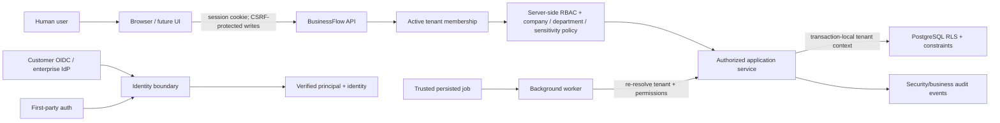

# BusinessFlow AI — Identity, Authorization and Tenant-Isolation Design

- **Status:** Security architecture proposal for owner review; nothing here is implemented or production-validated.
- **Owner-confirmed requirements:** First-party authentication plus OIDC/enterprise SSO; proper MFA; safe account linking and recovery; session management; server-side authorization policies. `Tenant` and `Company` are distinct, with a strict 1:1 MVP relationship.
- **Scope:** Requirements and recommended trust boundaries before any identity or authorization code is introduced. Keycloak/Authlib is a technical recommendation only; provider, package, policy and implementation choices remain pending owner approval.

## 1. Security objectives and evidence labels

The system must authenticate a human or non-human principal, resolve explicit tenant membership, authorize the exact operation and object scope server-side, bind a verified tenant to each database transaction, and record security-relevant events. A frontend filter, UUID, email address, model output, caller-supplied tenant ID, or PostgreSQL RLS policy alone is not authorization.

This document distinguishes **owner-confirmed requirements** from **proposed controls** and **unverified behavior**. All mechanisms below are proposals until they are approved, implemented and tested against a real PostgreSQL service and the supported identity providers.

## 2. Proposed trust-boundary flow

The model/provider never authenticates a person, chooses a tenant, grants permissions, approves its own action, or receives database credentials.

## 3. Identity and account model

### 3.1 Logical identities

The logical model separates:

- **`user_account`:** BusinessFlow's stable user identity and lifecycle state.
- **`external_identity`:** A verified login identity, keyed by provider/issuer and immutable subject (`issuer`, `subject`); may identify an OIDC account or a first-party credential account. Email is profile/communication data, not a globally unique authorization key.
- **`tenant_membership`:** Explicit, revocable relationship between a user and a tenant. Membership is the source of tenant access, not email-domain matching.
- **`access_role` / `permission` / `membership_role`:** BusinessFlow authorization assignments and scopes, separate from an employee's business job role.
- **Service identity:** Non-human integration/worker principal with explicit tenant scope, limited permissions, credential rotation and separate audit actor type. It is not represented as a human user.

These are proposed concepts; no table or migration has been created. The 1:1 tenant/company constraint is an MVP database restriction. Keeping `company_id` on company-scoped facts and authorization assignments allows a future 1:N relationship without making those facts company-ambiguous.

### 3.2 First-party authentication

The product must support a first-party sign-in path. **Current technical recommendation, not owner-approved:** use Keycloak 26.8.2 local accounts as the credential/MFA/recovery boundary and upstream OIDC broker instead of implementing password, MFA or recovery primitives in BusinessFlow. Use Authlib 1.9.10 only as the proposed server-side OIDC client integration. Version, compatibility, license and operating evidence are in [`TECHNICAL_BASELINE_PROPOSAL.md`](TECHNICAL_BASELINE_PROPOSAL.md).

Before implementation, recheck exact release/support/security advisories and configuration; define rate limits, non-enumerating responses, registration/invitation, tenant-admin bootstrap, email verification/SMTP, account disablement, credential reset, recovery and session revocation. BusinessFlow stores no password, MFA seed, reset token or recovery secret. The specific local-account policy and provider choice remain open for owner approval.

### 3.3 OIDC / enterprise SSO

The OIDC path should use a maintained provider library and validate issuer, audience/client, signature/algorithm, expiry, nonce/state, redirect URI and key rotation. Use an authorization-code flow with PKCE for browser clients. Never accept an unverified ID token, caller-provided subject, email, or role as proof of identity or permission.

Map a verified `(issuer, subject)` to an `external_identity`. Do not auto-provision tenant membership from an email domain unless a separately approved, tenant-admin-controlled policy explicitly allows it. OIDC login proves identity authentication; BusinessFlow still resolves membership and authorization itself.

The proposed boundary is Keycloak 26.8.2 as local first-party account service and OIDC broker, with Authlib 1.9.10 in the BusinessFlow server as OIDC client. BusinessFlow still resolves membership, authorization and company scope; IdP group claims do not grant those. Versions are recommendations only. Supported customer IdPs, issuer/claim allow-list, JIT provisioning, logout/session coupling, and behavior when an IdP is unavailable remain unselected.

### 3.4 Account linking and recovery

Linking OIDC and first-party methods can merge two identities and expose multiple tenants. Proposed safe flow:

1. Require an authenticated session for the existing account and fresh, independent proof of control of the identity being linked.
2. Do not merge accounts based on matching or verified email alone.
3. Show the user the identity and memberships affected; require confirmation and protect privileged links with MFA/step-up authentication.
4. Make linking/unlinking atomic, idempotent, auditable and reversible through a controlled support/recovery process; notify existing verified channels.
5. Define recovery for lost MFA/device, unavailable enterprise IdP, compromised email and tenant-admin lockout without creating an unaudited global bypass.

Recovery factors, support escalation and account-merge conflict handling require explicit product/security approval.

### 3.5 MFA

MFA is an owner-confirmed product requirement. The policy must define supported factors, enrollment, enforcement, step-up conditions, recovery codes, device replacement and administrator reset procedures. Recommended minimum: require MFA for tenant administrators and anyone approving or executing actions; require step-up authentication for high-risk account/security changes. Whether every user must enroll, and which factors (for example, phishing-resistant WebAuthn/passkeys or TOTP) are supported, remains open. Do not claim MFA protection until enrollment, recovery and bypass paths are tested.

## 4. Session management

Proposed browser-session properties, subject to implementation review:

- Prefer revocable server-side sessions represented to the browser by a high-entropy opaque cookie; do not store long-lived bearer credentials in browser local storage.
- Cookie flags: `Secure`, `HttpOnly`, appropriate `SameSite`, narrow path/domain; use anti-CSRF protection for state-changing requests and validate allowed origins.
- Rotate session identifiers after authentication, identity linking, MFA changes, privilege changes and reauthentication. Enforce explicit idle and absolute expiry.
- Provide session listing and revocation; revoke sessions on logout, account disablement, password/MFA reset and suspicious identity changes as policy requires.
- Require fresh authentication/MFA for defined sensitive actions; never accept a session's cached role as the sole authorization decision.
- Redact session identifiers, tokens, recovery artifacts and authorization headers from logs and traces.

Session recommendation: Keycloak owns its SSO session; BusinessFlow keeps a separate revocable `application_session` row containing a hash of an opaque browser token, user reference, authentication strength, issue/last-seen times, idle/absolute expiry and revocation state. The browser receives only a `Secure`, `HttpOnly`, appropriately `SameSite` cookie. Keycloak owns local passwords, MFA seeds, reset tokens and recovery secrets; BusinessFlow may record redacted `identity_recovery_event` metadata but never the recovery artifact. Membership is rechecked on requests; session tenant selection is not an authorization grant.

This is a recommendation, not an accepted session contract. Lifetime values, concurrent-session policy, cookie domain/origin, idle/absolute expiry, logout coupling, recovery factors, SMTP, device UX and emergency revocation remain open and must be approved and tested before login is implemented.

## 5. Authorization architecture

### 5.1 Request-time decision

Every API and background operation follows this sequence:

1. Authenticate the credential/session and validate its status, issuer/provider and expiration.
2. Resolve the requested tenant only from the authenticated principal's active membership. A tenant ID in a URL may select among memberships but cannot establish membership.
3. Resolve the target company/resource within that tenant. Reject mismatched tenant/company/object IDs even if each ID exists independently.
4. Evaluate server-side permission, action, object, company/department scope and sensitivity rules. Deny by default.
5. Apply the same authorization at the application service boundary, not only in route middleware or frontend navigation.
6. Bind the verified tenant to the database transaction; database RLS and tenant-aware foreign keys are defense in depth.
7. Record allowed and denied sensitive operations with actor, scope, target, reason/result and correlation ID, excluding secrets and unnecessary personal data.

### 5.2 RBAC and scoped policy

Use a permission catalog with narrowly defined capabilities, such as `tenant:manage`, `company:read`, `project:write`, `finance:read`, `workforce:capacity:read`, `workforce:compensation:read`, `decision:recommend`, `decision:approve`, `action:execute`, `integration:manage` and `audit:read`. These are examples, not a finalized permission schema or role list.

Roles group permissions; membership assignments can be scoped to a company and, where a real use case requires it, department or resource. Business job roles such as “project manager” or “developer” do not grant application permissions automatically. Compensation/cost rates require separate authorization from workforce capacity. UI hiding is usability only; the backend enforces every read and write.

### 5.3 Approval and action permissions

A recommendation is not an approval. Approval records must identify the authenticated human principal, tenant/company, exact recommendation version/option or immutable payload hash, applicable policy version, decision and timestamp. Never trust a free-text `by` or actor field from a request. Enforce separation of duties where approved policy requires it; prevent an agent/model from approving its own action. An approved action may execute only the exact approved payload, with an idempotency key, attempt records and independent verification. High-impact irreversible actions remain disabled in MVP.

### 5.4 Implemented M7 capacity-stage approval policy

The bounded M7 API enforces active tenant/company membership and these server-side capabilities: owner/admin `decision:read`, `decision:write` and `decision:approve`; member `decision:read` only. Owners/admins may submit and review, but the authenticated reviewer must differ from the submitter for the exact immutable decision version. This separation-of-duties rule is mandatory, not configurable, and is checked in both the service and database trigger; one review result is permitted per version. A superseding version requires fresh review and cannot inherit an earlier approval. Decisions and approvals bind the exact M6 assessment/intake and M5 metric evidence IDs and hashes, and stale/invalid evidence blocks new approval. The approver is taken from the authenticated request principal, never from submitted body data. `capacity_declined` is not commercial rejection; M7 has no financial decision or action execution. See [`M7_DECISION_APPROVAL.md`](M7_DECISION_APPROVAL.md).

### 5.5 Background jobs and administrative access

A worker receives a persisted, integrity-checked job ID, loads the associated tenant/object from the database, revalidates status and policy, binds tenant context for each transaction and records a service actor. Do not carry a caller-supplied tenant in an untrusted queue payload or add a general RLS-bypass flag.

Cross-tenant support/maintenance is a separate privileged path: narrowly scoped, time-limited, explicitly authorized, reason-recorded, monitored and audited. Its data access and emergency procedures need owner approval; no global support impersonation or ordinary application bypass is assumed.

## 6. Layered tenant isolation

1. **Identity:** Membership, not a submitted identifier, grants tenant access.
2. **Application:** Each request and service checks membership, permission, company/object scope and sensitive-field access.
3. **Relational integrity:** Tenant-owned tables carry `tenant_id`; company-scoped facts carry `company_id`. Composite foreign keys include `tenant_id`. Enforce the strict MVP 1:1 in PostgreSQL (unique, non-null `company.tenant_id` plus a deferred tenant-to-company reference or equivalent deferred constraint); validate the exact pattern before migration implementation.
4. **Database:** Enable and `FORCE ROW LEVEL SECURITY` for tenant-owned tables. Policies fail closed when transaction-local tenant context is missing. The runtime role is not a table owner and has no `BYPASSRLS`; migrations use a separate credential.
5. **Transactions/pooling:** Set tenant context only inside a transaction from the verified principal; use transaction-local settings and ensure rollback/connection reuse cannot retain the previous tenant.
6. **Jobs:** Re-derive tenant/object scope from trusted persisted job state before queries; no cross-tenant worker context.
7. **Audit:** Test isolation and authorization independently; do not treat RLS alone, an opaque UUID or a hash chain in the same database as sufficient security.

**Important limitation:** A PostgreSQL custom setting such as `app.tenant_id` is an application-provided context, not an independent identity credential. It is defense in depth against missing predicates when used correctly; it does not make arbitrary SQL execution safe if an attacker can run SQL as the application role and set the same context. Parameterized queries, narrow services, no exposed raw SQL, least-privilege DB credentials and backend authorization remain required.

## 7. Security controls and acceptance tests

Before identity/authorization implementation is accepted, require tests against the production database engine and each supported login flow. At minimum:

- OIDC: wrong issuer/audience/nonce/state/signature/expiry/redirect, algorithm confusion, key rotation, replay, unverified claims, disabled account and IdP key rollover.
- First-party: password hash/storage review, rate limiting, account enumeration, reset-token replay/expiry, MFA enrollment/recovery/bypass, admin bootstrap and credential-reset session revocation.
- Linking: duplicate email, stolen/expired link proof, concurrent link/merge, cross-tenant identities and unlink/recovery audit trail.
- Sessions: fixation/rotation, CSRF, cookie flags, expiry, logout, session revocation, privilege change and step-up requirements.
- Authorization: cross-tenant and cross-company IDs, endpoint/service bypass, read/write/delete, compensation and department scope, approval self-review, stale payload, agent identity forgery and denied-action audit.
- PostgreSQL: absent/invalid tenant context, RLS read/write/delete, composite FK mismatch, duplicate company per tenant, tenant-without-company and mismatched tenant/company pairing, runtime role without `BYPASSRLS`, owner/migration-role distinction, upsert paths, pooled connection reuse and background-job isolation.
- Operational: secret/key rotation, backup/restore of required identity/session state, security log redaction, admin emergency process and deployment misconfiguration.

The bounded M7 decision workflow covers its project-specific owner/admin/member permissions, cross-tenant/company scope, submitter self-review, stale evidence, forced RLS, composite-FK integrity, immutability, rollback and concurrency requirements with PostgreSQL integration tests. The broader identity-provider, first-party account, linking, session, operational and remaining authorization plan above is not all implemented or accepted; PostgreSQL and identity-provider acceptance cannot be replaced by SQLite or static code inspection.

## 8. Decisions required before implementation

- Review/approve or replace the Keycloak 26.8.2 + Authlib 1.9.10 recommendation, including local account policy, MFA factors, session storage and exact release/security configuration.
- Select OIDC providers/protocol profile, claims mapping, tenant invitation/provisioning and JIT rules.
- Decide MFA scope, factors, step-up actions, recovery and privileged reset process.
- Define secure linking/merging, deprovisioning, tenant-admin bootstrap, session lifetimes/revocation and support access.
- Finalize permission/role catalog, department boundaries, compensation access and approval separation-of-duties.
- Approve PostgreSQL roles, RLS policy convention, tenant context setting, migration privilege and operational access model.
- Define multi-tenant-per-installation topology separately from the one-company-per-tenant MVP model.

Until these decisions and their threat tests are approved, this document is a security design proposal—not an authorization to implement authentication, infrastructure or migrations.
