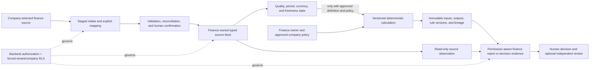

# BusinessFlow — Financial Intelligence Architecture

- **Status:** M9 target architecture and code assessment. No financial rule, formula, accounting policy, FX policy, rounding rule, threshold, or new data model is approved by this document.
- **Critical distinction:** M8 is an implemented **project-scoped observation and policy-gated assessment slice**, not company-wide Financial Intelligence. The target is optional, finance-governed intelligence across the selected Company as a whole; it is not implemented.
- **Related evidence:** [`../BACKEND_IMPLEMENTATION.md`](../BACKEND_IMPLEMENTATION.md), [`CURRENT_VS_TARGET_GAP_ANALYSIS.md`](CURRENT_VS_TARGET_GAP_ANALYSIS.md), and migration [`../../migrations/versions/0007_financial_feasibility.py`](../../migrations/versions/0007_financial_feasibility.py).
- **Post-M9 scope note:** Migration `0008_monthly_position_review` adds only an exact-template, synthetic-only finance CSV inside the internal M10 demo. Migration `0011_finance_source_intake` later adds M14's separate manual CSV contract, profile, mapping, and caller-supplied arithmetic comparison. Migration `0012_financial_calculations` adds an M15 prototype for one exact, mechanical subtotal of a complete M14 group, with keyed row-amount commitments and replay evidence. M14 and M15 are not a general Company finance source system or policy-governed Financial Intelligence implementation; both APIs are default-disabled, M15 is hard-blocked in production, and M14's finance-owner/source/access/correction/retention/independent-control gates remain unresolved. No financial formula or accounting policy is approved by this architecture document. See [`../M10_SYNTHETIC_DEMO.md`](../M10_SYNTHETIC_DEMO.md), [`../M14_FINANCE_SOURCE_CONTRACTS.md`](../M14_FINANCE_SOURCE_CONTRACTS.md), and [`../M15_DETERMINISTIC_FINANCIAL_CALCULATIONS.md`](../M15_DETERMINISTIC_FINANCIAL_CALCULATIONS.md).

## 1. M8 behavior verified in code

M8 adds a useful controlled pattern, with deliberately incomplete financial logic:

| Evidence | Actual implementation |
|---|---|
| Schema | Migration `0007_financial_feasibility` creates `project_financial_input_cases`, immutable `project_financial_input_versions`, and immutable `financial_assessments`. All three are tenant/company scoped and forced through RLS. Composite FKs bind financial inputs and assessments to a project intake and exact M5/M6/M7 evidence. Database guards enforce append-only versions and exact-current-head/handoff binding. |
| Input scope | The API is nested under `/api/v1/tenants/{tenant_id}/project-intakes/{intake_id}` in [`../../src/businessflow/api/financial_assessment_routes.py`](../../src/businessflow/api/financial_assessment_routes.py). Inputs are one versioned stream per project intake, not company-level finance records. |
| Accepted observations | [`../../src/businessflow/financial_assessments/schemas.py`](../../src/businessflow/financial_assessments/schemas.py) accepts sourced `commercial_amounts` (`contract_value` or `reported_revenue`), `cost_observations`, `effort_hours`, free-text `payment_terms`, and `known_risks`. Each observation has source/assumption metadata. These are user-entered observations, not a ledger, revenue-recognition model, expense system, invoice/receipt model, budget, or cash position. |
| Exact input representation | Monetary/effort values are decimal **strings**; currency is validated as ISO 4217. The snapshot preserves supplied decimal text. The catalog states no FX/cross-currency arithmetic and no rounding; no converted or aggregated amount is emitted. |
| Policy status | [`../../src/businessflow/financial_assessments/catalog.py`](../../src/businessflow/financial_assessments/catalog.py) has empty `APPROVED_FINANCIAL_POLICIES` and `APPROVED_FORMULA_DEFINITIONS`, status `no_approved_policy`, no policy administration, and no effective dates. |
| Assessment output | [`../../src/businessflow/financial_assessments/calculation.py`](../../src/businessflow/financial_assessments/calculation.py) returns `financial_verdict = incomplete`, an empty `calculated_metrics` list, observations, assumption attribution, missing inputs, warnings, currency codes, and no rounding. No financial formula is executed. The database `CHECK` constraint also requires `financial_verdict = 'incomplete'` and null approved-policy identifiers. |
| Handoff and authorization | Financial-assessment creation requires the current fresh M7 `proceed_to_financial_evaluation` decision and a separate approved M7 review. Finance read/write permissions exist in the fixed owner/admin role matrix; members have no finance permission. This is not a configurable finance-role, ledger-approval, or company policy-management system. |
| Tests | [`../../tests/test_financial_assessments.py`](../../tests/test_financial_assessments.py) covers source observations, snapshot replay, versioning/staleness, exact decimal strings, current approved handoff, authorization, forced RLS, runtime grants, concurrency, rollback, and migration upgrade/downgrade/re-upgrade. These tests validate the bounded M8 contract, not accounting correctness of a future model. |

M8 therefore supplies patterns worth extending: typed, sourced observation inputs; exact decimal-text preservation; versioned immutable snapshots and content hashes; explicit currency list and assumption attribution; no-policy/incomplete behavior; evidence links; and least-privilege RLS. It does **not** provide company-wide financial fact coverage or calculate revenue, expenses, profit, margin, cash flow, forecasts, budgets, receivables, or financial feasibility.

## 2. Target boundary and domain ownership

Financial intelligence should be an optional, finance-governed domain within the modular monolith. It should not become a universal finance schema imposed on every company, and it should not replace the customer’s books of record.

The target scope is **company-wide Financial Intelligence**: governed financial facts and, where explicitly approved, calculations and answers for the selected Company across its relevant operations—not just projects or project acceptance. Projects are one consumer of finance evidence, not the finance-domain boundary. “Company-wide” still means the one current Company associated with a Tenant; it does not imply multi-company consolidation, intercompany accounting, a universal chart of accounts, or mandatory support for every financial concept.

Keep distinct concepts distinct where a selected use case requires them. Potential source fact families for owner selection include reported amounts, contracts/proposals, invoices/receivables, receipts, expenses/cost observations, budgets, commitments, and cash-position observations. This is a list of candidate *source concepts*, not a prescribed accounting model or a commitment to implement every category. A source label must not silently determine recognition, classification, allocation, or financial treatment.

A future financial fact contract should be reviewed by an accountable company finance/accounting owner and explicitly state, as applicable:

- which source system/record is authoritative and who owns it;
- source identifier, original value, source currency, observation/as-of time, effective/business date or period, status, and correction/version behavior;
- meaning and permitted use of each fact, including distinctions between proposed, contractual, reported, invoiced, receivable, received, planned, and actual amounts where those distinctions apply;
- company-specific fiscal/calendar/period basis and any permitted dimensions;
- data classification, who may read or change a fact, and how access is audited;
- freshness, completeness, conflict-resolution, missing-value, zero-attestation, and reconciliation behavior;
- retention, privacy, audit, and export/delete requirements.

Do not assume a universal account chart, accounting standard, revenue-recognition rule, cost allocation, tax treatment, direct/indirect classification, contribution or margin definition, liquidity measure, FX source, rounding/precision policy, or decision threshold. These are policy inputs to be decided by the accountable owner, not product defaults.

## 3. Target processing and evidence flow

M8 implements the project-scoped sourced-observation/always-incomplete assessment portion. M14 separately implements a manual finance-specific CSV intake with explicit mapping, profiling, row-quality evidence, freshness labels, and caller-supplied control comparison. M14 does not use or alter M4/M12 contracts, create canonical finance facts, authenticate source authority, or establish an accounting conclusion; its source, correction, retention, and independent-control governance remains unapproved. The target flow does not require a separate data platform; the M14 slice stays within the current PostgreSQL/modular-monolith design.

### Evidence Before Answers — No evidence, no confident answer

For any future financial answer or AI-assisted explanation, enforce the approved foundational principle through these contracts:

1. **Evidence-grounded:** cite the authorized company finance fact and its original source record, status, period/as-of date, and scope; a label such as “revenue” or “cost” is not sufficient provenance.
2. **Traceable and verifiable:** expose the exact inputs and, only when policy-approved, calculation definition/code version, FX source/date if applicable, policy version, intermediate/result evidence, and hashes for inspection.
3. **Transparent:** show assumptions, source quality/freshness, uncertainty, limitations, and missing/conflicting facts; distinguish raw observations from interpretations and derived amounts.
4. **Permission-aware:** authenticate and authorize the requesting principal for the finance facts before retrieval and again before returning an answer. Enforce company scope and any sensitive-field policy; never use an LLM or retrieval index as the authorization boundary.
5. **Honest about insufficient data:** if required source evidence is missing, stale, conflicting, unreliable, unauthorized, or the accounting/calculation policy is absent or out of scope, return an explicit incomplete/readiness result and abstain from a confident financial conclusion.
6. **Reproducible:** preserve the relevant input/evidence IDs and versions, calculation implementation/definition, policy version, period, and hashes for every important assessment or decision so the same approved inputs and rules can be replayed.

These are target requirements. M8 implements exact sourced observations and immutable, hash-bound snapshots for one project intake, forced RLS, and the intentionally `incomplete` policy gate; it does not implement financial answer generation, company-wide finance retrieval, or AI.

### Required calculation and governance contract (future, policy-gated)

For each approved financial result, the future system should preserve an immutable input snapshot and result snapshot, with the exact source facts and versions, company scope, reporting period, source currency, code/calculation version, approved policy identifier/version/effective scope, data-quality state, warnings/limitations, and canonical hashes. A replay against the same inputs and versions must reproduce the same output. Any source or approved policy change creates a new result; it must not overwrite history.

Before implementation of a calculation, the named finance owner should approve a written specification and reviewed golden examples covering the intended behavior and edge cases. That specification must settle any needed sign convention, time/period basis, source precedence, aggregation, FX source/date, precision, rounding, and missing/zero behavior. This architecture does not supply any of those values. If the policy is absent, conflicting, expired, or outside its approved scope, the service emits no derived financial conclusion and returns an explicit incomplete/readiness state.

Financial rules must be constrained, versioned, reviewed application logic or a separately validated declarative representation. Do not execute arbitrary SQL/Python or model-generated formula code. AI/LLMs may assist with language or explain approved outputs only within data permissions; they may never be the source of a financial value, formula, accounting interpretation, threshold, or approval. If a financial AI capability is separately approved, it must support local/on-prem inference in a customer-controlled deployment and must not require transmitting company data to an external model. This is a target architecture requirement, not an implemented capability; no LLM, inference runtime, provider, or vector store is selected.

## 4. Security, isolation, and human control

- Continue deriving tenant and company scope from authenticated membership and canonical company resolution. Never trust a caller-supplied `company_id`, tenant identifier embedded in an imported row, or model-provided scope.
- Financial tables require forced RLS, tenant/company composite keys, non-owner/non-`BYPASSRLS` runtime role, and explicit service-layer permissions. Use narrower finance access than ordinary operational read access when the domain and customer policy require it.
- Current roles are fixed: [`../../src/businessflow/authorization.py`](../../src/businessflow/authorization.py) grants `finance:read`/`finance:write` to owner/admin and not member. A general finance-steward or field-level access model has not been implemented. Do not claim it exists; design it only with a real access use case and tests.
- Keep source values, derived metrics, policy versions, decision submissions, approvals, and execution separate. An approved M7 project-stage handoff is not approval of a financial formula or financial result.
- Any future approval must bind the authenticated reviewer to the exact result and evidence hashes; a change in relevant input or policy invalidates freshness. The reviewer must satisfy the company’s approved separation-of-duties policy.
- Do not expose sensitive values through audit metadata, error messages, model prompts, or unauthorized readiness summaries. Preserve M8’s behavior of recording identifiers/hashes rather than source amounts in audit details.

## 5. Bounded M14/M15 implementation and remaining gates

M14 implements a narrower engineering slice than the finance fact model described above: one manual finance-specific CSV contract, exact header mappings and rationale-backed ignored columns, column profiling, row hashes/status/issues, caller-supplied source-as-of/freshness fields, and Decimal comparisons to caller-supplied control amounts/tolerances. It persists immutable Company-scoped evidence, but not raw row values, canonical finance facts, a ledger, or accounting classifications. It reuses M11's arithmetic primitive rather than adding a formula catalog; it does not alter M4/M12 or M8.

M14 deliberately does not select a finance owner or authoritative source/access path and does not define a correction or legal retention policy. Its duplicate key (`source_record_id` within one intake) and control-overlap checks are narrow engineering conventions, not an owner-approved domain policy. A caller-supplied control reference does not prove independence. These open gates prohibit treating the implementation as production/customer-accounting-data approval. See [`../M14_FINANCE_SOURCE_CONTRACTS.md`](../M14_FINANCE_SOURCE_CONTRACTS.md).

The M15 prototype adds a default-disabled exact subtotal for one complete M14 group after validating row-bound `app-secret.v1` amount commitments. It delegates arithmetic to the M11 exact Decimal sum, records only hashes/redacted evidence in its append-only run table, and requires the caller to resubmit amounts for replay. It does not decide account classification, source authority, control independence, fiscal semantics, or an approved formula. It is hard-blocked in production and is not milestone completion or an accounting-policy approval. See [`../M15_DETERMINISTIC_FINANCIAL_CALCULATIONS.md`](../M15_DETERMINISTIC_FINANCIAL_CALCULATIONS.md).

If a later owner-approved company-level finance fact model is needed, it must first name the accountable owner and source; define typed fields, period/date/currency meaning, source identity, correction/version semantics and retention; set quality/freshness/conflict/missing-data behavior; and pass PostgreSQL scope, RLS, grant, history, privacy and reconciliation tests. It must not invent or silently apply a formula, sum across currencies, round, normalize currencies, assert accounting treatment, fill a blank with zero, predict collections, rank outcomes, or issue a financial verdict. A missing approval keeps the relevant behavior blocked; the M15 prototype is not an owner-approved finance fact model and does not change these gates.

## 6. Explicit non-goals until separately approved

No general ledger or accounting close; chart of accounts; statutory or tax accounting; universal revenue recognition; profitability/contribution/margin, cash-flow/liquidity, budget variance, forecast, FX conversion, payment probability, credit risk, or cross-company consolidation; generic finance import connector catalog; arbitrary accounting SQL; LLM financial arithmetic; autonomous recommendation/approval/action; or finance administration UI is implemented by M8/M14 or implied by the single mechanical M15 subtotal. No company-specific finance policy can be inferred from M8/M14/M15 schemas, controls, or tests.

## 7. Repository pointers

- M8 input contract and policy gate: [`../../src/businessflow/financial_assessments/schemas.py`](../../src/businessflow/financial_assessments/schemas.py), [`catalog.py`](../../src/businessflow/financial_assessments/catalog.py), [`calculation.py`](../../src/businessflow/financial_assessments/calculation.py), and [`service.py`](../../src/businessflow/financial_assessments/service.py).
- M8 persistence/RLS/guards: [`../../migrations/versions/0007_financial_feasibility.py`](../../migrations/versions/0007_financial_feasibility.py) and [`../../src/businessflow/financial_assessments/models.py`](../../src/businessflow/financial_assessments/models.py).
- Current project-scoped route: [`../../src/businessflow/api/financial_assessment_routes.py`](../../src/businessflow/api/financial_assessment_routes.py).
- Current M8 verified boundary tests: [`../../tests/test_financial_assessments.py`](../../tests/test_financial_assessments.py) and [`../../tests/test_migration_financial_assessment.py`](../../tests/test_migration_financial_assessment.py).
- M14 contract, routes, mapping, reconciliation and limitations: [`../M14_FINANCE_SOURCE_CONTRACTS.md`](../M14_FINANCE_SOURCE_CONTRACTS.md); implementation under [`../../src/businessflow/finance_sources/`](../../src/businessflow/finance_sources/) and [`../../src/businessflow/api/finance_source_routes.py`](../../src/businessflow/api/finance_source_routes.py); unit/API/RLS tests in [`../../tests/unit/test_finance_sources.py`](../../tests/unit/test_finance_sources.py), [`../../tests/test_finance_sources.py`](../../tests/test_finance_sources.py), and [`../../tests/test_finance_sources_rls.py`](../../tests/test_finance_sources_rls.py).
- M15 experimental mechanical-only subtotal, keyed amount commitments, default-off routes, evidence/replay and remaining gates: [`../M15_DETERMINISTIC_FINANCIAL_CALCULATIONS.md`](../M15_DETERMINISTIC_FINANCIAL_CALCULATIONS.md); implementation under [`../../src/businessflow/financial_calculations/`](../../src/businessflow/financial_calculations/) and [`../../src/businessflow/api/financial_calculation_routes.py`](../../src/businessflow/api/financial_calculation_routes.py).
