# BusinessFlow — Target Domain Architecture

- **Status:** Owner-directed minimum target architecture for integrated BI, Financial, Operational, and Decision Intelligence. Reuse the current modular monolith and PostgreSQL; distinguish shipped, in-progress, and gated capabilities. This is not approval for finance policy, production/customer-data use, or new infrastructure.
- **Current increment:** PR #26 (`d4c80d525a819b1a97eb14c54d228d106a0f741b`) adds a narrow M4–M7 capacity UI. The Company Data Foundation includes the earlier coverage/source-review UI over existing M4/M12 contracts. This branch adds an unnumbered Phase 1 manual customer-delivery commitment workflow with a Company-scoped contract, review history, and file evidence; it is not an M4 import or Core Financials measure. No connector or new numbered milestone is implied. M17–M25 remain proposals. See [`CURRENT_VS_TARGET_GAP_ANALYSIS.md`](CURRENT_VS_TARGET_GAP_ANALYSIS.md), [`../BACKEND_IMPLEMENTATION.md`](../BACKEND_IMPLEMENTATION.md), and [`../roadmap/PRODUCT_ROADMAP.md`](../roadmap/PRODUCT_ROADMAP.md) for current boundaries.
- **Product context:** [`../product/PRODUCT_VISION.md`](../product/PRODUCT_VISION.md) describes target data paths for fragmented, spreadsheet-led, and no-system businesses. AI is an evidence-grounded interface/reasoning layer, not a source of facts, calculations, or authority.
- **Architecture constraints:** Keep modular monolith, PostgreSQL, forced RLS, backend authorization, immutable evidence, deterministic calculations, human-controlled decisions, and customer-controlled deployment options. Local/on-prem inference is a target for any future approved AI; no AI runtime is implemented. Do not add infrastructure without demonstrated need.
- **Architecture constraints:** Keep the modular monolith, PostgreSQL, forced RLS, backend authorization, immutable evidence/history, deterministic calculations, human-controlled decisions, self-hosted/on-prem-first deployment, and cloud portability. Local/on-prem inference is a target requirement for any future approved AI capability, not a current implementation. Add no service, database, workflow engine, or generic abstraction without demonstrated need.

## 1. Design objective

Support analyses and human decisions across a company’s **selected** business domains while keeping domain facts and rules owned by the domain that defines them. A company may use only workforce and operations, only finance, or other combinations. BusinessFlow should compose supported, governed evidence for a particular question; it should not make every tenant implement a large universal enterprise schema.

The existing data model is narrower than this target. Workforce and projects are the current implemented domain slices; projects are one supported business domain, not the product boundary. The first durable architectural step is to extend proven bounded-context patterns, not to replace the working backend or pretend that future domain modules already exist.

## 2. Current platform posture to retain

The repository is a Python/FastAPI modular-monolith application using SQLAlchemy, Alembic, PostgreSQL, and a few static HTML/JavaScript workflows. There is no unified BI experience, live connector framework, broad analytical layer, AI runtime, or permission-aware AI retrieval. Migrations `0001_backend_foundation`–`0018_customer_commitments` support bounded M2–M8, M10, M12–M16, Phase 1 manual customer commitments, and default-disabled Core Financials capabilities. See [`../BACKEND_IMPLEMENTATION.md`](../BACKEND_IMPLEMENTATION.md).

Retain these concrete controls and patterns:

- `Tenant` is the security boundary and `Company` is separately identified. Current schema cardinality is one company per tenant, enforced by `uq_companies_one_per_tenant` and the tenant-to-primary-company composite foreign key in [`../../migrations/versions/0001_backend_foundation.py`](../../migrations/versions/0001_backend_foundation.py). Do not remove or generalize this invariant just because the product direction is company-wide. Decide separately if a real workflow requires multiple companies or group reporting.
- Backend services verify membership and permissions; the authorized company is resolved from the tenant, not selected by an untrusted request body. Transaction-local `app.user_id`, `app.tenant_id`, and `app.company_id` context supports forced PostgreSQL RLS. Runtime and migrator roles are separated.
- Company-scoped records use composite tenant/company references where appropriate. M5–M8 show versioned snapshots, content hashes, scope binding, immutable history, and exact evidence references.
- Calculations remain deterministic service logic. M5 separates calculation from persistence; M6 consumes the M5 result instead of duplicating its calculation; M8 preserves observations and emits no financial metric while policy is absent.
- Existing routes, package names, tables, and migration history are retained. A future domain adapter can add a typed subject path without renaming or replacing current project endpoints.

## 3. Proposed bounded contexts

The first column describes the target responsibility. The implementation status column is explicit: target modules below are not all present in `src/businessflow`.

| Context | Owns | Current evidence / target boundary |
|---|---|---|
| Identity, tenancy, and authorization | Users, memberships, tenant/company access, permissions, session state, and audit identity. | **Implemented foundation.** `models.py`, `authorization.py`, `services/tenancy.py`, `services/company_context_access.py`, and migration `0001` provide a fixed owner/admin/member policy. Extend policy only for an approved domain; do not equate employee/job titles with app permissions. |
| Company context and optional organization | The company identity and only those organizational dimensions a workflow needs. | **Partially implemented.** `company_context` includes business units, departments, employees, skills, capacity, projects, and assignments. It does not model flexible branch/location/legal-entity structures or user-defined arbitrary hierarchies. Add optional, typed concepts only as required. |
| Domain facts | Typed, source-aware business facts and lifecycle rules for an enabled area (for example finance, workforce, operations, commercial, or procurement). | **Narrowly implemented for workforce/project context; broader contexts are not implemented.** Each domain owns its vocabulary and validation. An optional module must not force its fields on every company. |
| Data intake and quality | File/source metadata, staging, explicit field mapping, validation, confirmation, reconciliation, and traceability to source records. | **M4 bounded intake and M12 Company-scoped source/evidence registry implemented.** M4 handles six workforce/project datasets; this branch adds coverage/review UI over existing evidence. M14 has a separate manual finance CSV intake. No general connector or scheduled sync. |
| Domain analytics and evidence | Versioned, deterministic definitions, bounded input snapshots, results, quality state, and lineage for an enabled domain. | **Narrow M5 foundation implemented.** Five non-financial observations are explicitly draft/observational. Broader analytics should remain domain-owned before any cross-domain composition. |
| Company analytics / read models | A permission-aware read-only composition over approved domain facts for a defined report or question. | **Not implemented as a general capability.** Start with an in-process service/read model in PostgreSQL. Consider materialized views or another store only after measured query, scale, retention, or isolation needs justify the complexity. |
| AI-assisted answers and evidence retrieval | Natural-language assistance over a bounded, authorized evidence set, with source/calc lineage and explicit abstention. | **Not implemented.** No AI runtime, model provider, vector store, or permission-aware retrieval exists in current code. Future AI must satisfy Evidence Before Answers and support customer-controlled local/on-prem inference; no specific runtime is selected. |
| Decision evidence and lifecycle | A question, typed subject, exact input/evidence versions, limitations, human decision, optional independent review, and later supersession/outcome. | **Project-specific M6–M7 implementation exists.** Extend by introducing domain adapters and typed subject references only when another real use case needs them; do not convert project IDs into an unchecked polymorphic `entity_type/entity_id` field. |
| Financial intelligence | Company-wide financial source facts and, when approved, definitions, deterministic calculations, and reviewable outputs across the selected Company’s relevant domains. | **M8 project-scoped observations and an intentionally incomplete assessment exist.** No company-wide finance fact model, formula, or approved policy exists. The target is company-wide within the current one-Company-per-Tenant boundary, not a project-only finance module or multi-company consolidation. See [`FINANCIAL_INTELLIGENCE_ARCHITECTURE.md`](FINANCIAL_INTELLIGENCE_ARCHITECTURE.md). |
| Product experience | Authorized ways to inspect source/data quality, analysis evidence, and decision history. | **Narrow static workflows implemented** for synthetic M10, capacity PR #26, and default-disabled Core Financials. This branch adds the Company Data Foundation UI. No unified BI workspace or general onboarding flow exists. |
| External actions and outcomes | Separately approved, idempotent execution and later outcome evidence, if validated. | **Not implemented in the reviewed repository.** M7 approvals do not execute a business action. Keep this out of the initial company-wide data slice. |

## 4. Data and trust flow

```mermaid
flowchart LR
    SRC[Company-selected source systems or files] -->|file staging is current; connectors are future| IN[Domain-aware intake, mapping, validation]
    IN --> Q[Data quality and reconciliation]
    Q -->|explicit confirmation and provenance| DOM[Enabled domain-owned facts]
    DOM --> CALC[Versioned deterministic domain calculations]
    CALC --> EVD[Immutable snapshots, quality state, and lineage]
    DOM --> READ[Permission-aware read-only company view]
    EVD --> READ
    READ --> CASE[Typed decision evidence for a selected question]
    CASE --> HUMAN[Authorized human decision]
    HUMAN --> REVIEW[Optional separate human approval]
    REVIEW -. future, separately authorized .-> ACTION[External/internal action]
    ACTION -. future verification .-> OUTCOME[Outcome evidence]
    AUTH[Backend authorization + transaction-local tenant/company context + forced RLS] -. governs .-> IN
    AUTH -. governs .-> DOM
    AUTH -. governs .-> READ
    AUDIT[Append-only audit/evidence history] -. records .-> CASE
```

The diagram is a target flow; only the bounded file import, current domain facts, M5 runs, M6 capacity assessment, M7 project-stage decision/approval, and M8 project financial observation/assessment portions exist. No connector, company-wide analytical layer, AI runtime, general decision subject, action runner, or outcome service is implied by the diagram.

### Evidence Before Answers — No evidence, no confident answer

For any future AI-assisted answer or analysis, the architecture must:

1. **Evidence-grounded:** link each material claim to authorized company data and identifiable source records.
2. **Traceable and verifiable:** preserve inspectable calculation inputs, definitions, code versions, and results.
3. **Transparent:** state assumptions, limitations, uncertainty, freshness, and missing/conflicting information.
4. **Permission-aware:** authorize the requester and enforce tenant/company/domain permissions before retrieval and again before returning an answer; an LLM is never an authorization boundary.
5. **Honest about insufficient data:** abstain from confident conclusions when evidence is incomplete, unreliable, unauthorized, or governed by an unapproved policy.
6. **Reproducible:** preserve the relevant input, calculation, policy, and evidence versions for replay of important assessments and decisions.

The implemented M2–M8 slices supply bounded provenance, forced-RLS authorization, deterministic snapshots, hashes, and evidence-binding patterns in existing workflows. They do not implement AI retrieval, AI answers, or an inference runtime. If a future AI capability is separately approved, it must support local/on-prem inference in a customer-controlled deployment; no model, provider, or runtime is selected.

Recommended trust sequence for any future slice:

1. Identify a company-selected source and the authoritative meaning/owner of its facts.
2. Stage and validate input; show mapping, duplicates, errors, freshness, and unresolved conflicts before promotion.
3. Persist typed, tenant/company-scoped domain facts with source status and lineage. Keep raw, canonical, and derived representations distinct.
4. Run a reviewed deterministic calculation over a bounded, reproducible snapshot. If its required rule or financial policy is unapproved, return observations or an explicit incomplete state—not a guessed result.
5. Build an authorized read-only view that discloses scope, period, status, definition version, source evidence, assumptions, and limitations.
6. If a decision is in scope, preserve the exact evidence and policy version; an authorized human creates the decision and, where policy requires it, a different authorized human reviews it.
7. Treat execution and outcome measurement as later, separate capabilities; neither is inferred from an approval record.

## 5. Decision lifecycle: reusable pattern, not a workflow engine

M7 demonstrates useful controls but is scoped to one `project_intake_id`, one M6 capacity assessment, and M5 metric evidence. A future lifecycle could reuse those controls without replacing M7 or making every domain share the same decision fields:

| Step | Proposed contract |
|---|---|
| 1. Define the question | A selected decision type states the question, owner, company, decision window, and applicable policy; no universal decision taxonomy is assumed. |
| 2. Bind a typed subject | The relevant domain adapter references a known subject using typed, same-tenant/company integrity (or a small reviewed type registry with database-enforced ownership); arbitrary IDs are not trusted. |
| 3. Freeze evidence scope | Capture the exact source/domain record versions, input snapshot, period, calculation versions, assumptions, and content hashes used for this review. |
| 4. Evaluate evidence quality | Record missing, stale, conflicting, estimated, unsupported, or unauthorized inputs distinctly. Unknown is not zero. No conclusion is emitted where a required policy or reliable input is absent. |
| 5. Present supported analysis | A deterministic domain service may produce versioned metrics/scenario results. An LLM cannot be the numeric or policy authority. Each result carries definition, unit, period, source lineage, and limitations. |
| 6. Record human decision | Append a decision version with authenticated actor, rationale, chosen outcome, and exact evidence/policy hashes. Do not let a model or client nominate the actor. |
| 7. Review when required | Backend authorization checks the company policy. Separation of duties, if required, is enforced in service and database; approval binds the exact submitted version and becomes stale when its inputs change. |
| 8. Supersede, act, or learn | New evidence creates a new version; prior history remains. A later action requires its own authorization and verification. Outcomes are separate and do not rewrite the decision. |

The first extension should be a small domain adapter around a proven business question, not a generic case/subject/workflow schema covering hypothetical domains. Preserve M7's project-specific routes and tables for compatibility and evidence continuity.

## 6. Organization and company scope rules

- `Tenant` remains a distinct security boundary; `Company` remains the business context. The current enforced one-company-per-tenant rule is retained until a separately approved requirement and migration exist.
- “Company-wide” first means across the chosen data and users within that one current Company. It does not silently add group consolidation, cross-company sharing, or multi-company authorization.
- Current `business_units` and `departments` are concrete but limited structures: business units have no parent relation; a department can point to one optional business unit; locations, branches, legal entities, nested organizational trees, and effective-dated reporting relationships are not present.
- A module is optional at product/configuration level. Do not create a universal nullable business table that tries to represent every function, or a generic dimension hierarchy before a selected use case proves it necessary.
- Sensitive financial and employee data require explicit domain permissions and backend checks in addition to tenant/company RLS. Current authorization is fixed at owner/admin/member; it is not a configurable domain-role or attribute-based access-control system.

## 7. Storage, analytics, and deployment choices

- **Retain PostgreSQL first.** The implemented M2–M8 slices use PostgreSQL constraints, JSONB evidence snapshots, forced RLS, and transaction-local scope. One database and one deployable modular monolith remain the default.
- **Keep the source of truth explicit.** PostgreSQL read models/materialized views may be considered for a measured query need, but should not become uncontrolled alternate canonical facts. A separate warehouse/lakehouse, broker, cache, or analytics engine has no demonstrated requirement in this repository.
- **Keep calculations inside reviewed services.** Do not execute user/LLM-supplied SQL, formulas, or arbitrary code as business truth. Version code and definition together, preserve input/output snapshots, and replay saved inputs under their recorded version.
- **Support local/on-prem AI when AI is approved.** Any future model-assisted feature must be operable with customer-controlled local/on-prem inference and must not require external model transmission. This is an architectural target only; no LLM, inference runtime, provider, vector store, or AI feature is selected or implemented.
- **Preserve deployment portability.** The existing Compose setup is a local/self-hosted deployment baseline, not a complete production runbook. Production backup/restore, monitoring, secret rotation, operating procedures, and capacity limits still need owner-approved plans.
- **Do not add microservices or a workflow engine now.** Domain packages and service interfaces in a modular monolith are sufficient unless measured deployment, ownership, scale, or reliability needs demonstrate otherwise.

## 8. Change gate

Before a new domain implementation: select a user and decision question; name its data owner and source; agree a typed data contract and authorization; define freshness, retention, and correction needs; obtain domain/finance policy approval for any calculation; specify immutable evidence and failure behavior; and write real PostgreSQL RLS/FK/privilege tests. The implementation plan should then add only that vertical slice and leave unrelated optional domains absent.
